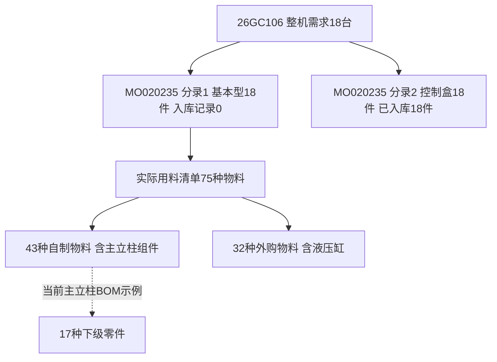

# 高昌工厂现状与金蝶数字化优化分析

2026年10月12日

**建议把第一阶段目标定为：围绕一条整机订单，让计划人员能够提前知道缺什么、当前在哪里、由谁补齐、什么时候能进入下一工序，并让这些判断有可核对的记录。**

公司已有金蝶、MRP、生产工单、采购流转和部分MES报工能力。两天的交流反映，物料实物、库存账、工序执行与部门计划之间仍有衔接缺口；单个零件或部门完成了很多工作，整机仍可能因一个组件未配齐而无法交付。技术改进需要同时明确业务责任、数据口径和现场记录方式。

本报告结合10月11日刘博流程说明、10月12日余总与PMC面试资料、现有MES交付主档，以及广州高昌组织的金蝶只读查询。访谈中的角色和数字仍有机器转写误差；接口快照仅代表当前账号可见的系统记录。这里所说的“拆解金蝶内核”，覆盖业务模型、单据状态、来源关系、计算口径和ERP与MES的回写机制。

## 一 工厂现状的主要判断

### 已有基础

- 销售先询期、确认机型配置，再形成正式销售订单；计划人员结合库存与生产安排回复交期。
- MRP形成需求后，人员继续判断使用库存、按单生产或批量备货。专用件、通用件、自制件、外购件和外协件的处理方式不同。
- 工厂已使用生产工单、工序计划、采购、入库与出库单据；部分工序已有员工扫码报工和人工验证。
- 公司有盘点及差异调账。10月12日交流说明，标准紧固件与部分加工件、外协件的账实差异程度不同。
- 本新MES项目已有手机、一体机、报工和质量等功能建设，现有交付主轴是焊接排产、齐套和可信报工。

这些基础可以用于改进。当前资料不能支持“工厂完全没有库存管理”“完全没有报工”“全部库存都不准”或“金蝶官方已停止维护”等结论。

### 需要优先解决的衔接

| 现状或问题 | 对生产的影响 | 依据与当前判断 |
|---|---|---|
| 部分内部领料发生后没有及时记录实发数量 | 账面余额可能包含已经转到现场的物料，计划需要额外查找和询问 | 刘博流程说明；10月12日仓库讨论 |
| 大件分布在车间与现场，小件多在仓库 | 同一系统仓库可能对应不同实物位置，找料与交接耗时 | 两天交流均提到 |
| 部分补料到收到工序单、配料或装配时才提出 | 自制、外协、供应商及运输周期进入等待时间 | 10月12日原材料需求覆盖与急件讨论 |
| 主计划下发后，各部门继续自行拆分 | 上工序的产出顺序可能没有接上下工序的齐套时间 | 10月12日企业讨论06:27至07:42 |
| 零件齐套与整机组件齐套需要分别管理 | 某个组件完成很多，仍可能不能形成可交付整机 | 10月12日企业讨论08:02至08:50 |
| 部分工序已有扫码报工，覆盖和金蝶回写仍需验收 | MES报了工、金蝶保存了单、金蝶审核反写之间可能有时间差 | 访谈与本新MES交付主档 |
| 计件收入与部门局部排产存在协调压力 | 容易做的件、能维持本部门产量的件，可能先于整机关键缺口 | 访谈提出的管理风险，尚不能归责具体员工 |
| 老员工熟悉产品，部分岗位替岗能力有限 | 新人查数据、理解工单和独立操作的成本较高 | 10月12日仓库讨论04:22至06:17 |
| 交期、工单完工日、工序结束日可能分别维护 | 管理者看到的“到期”“延期”可能使用不同口径 | 本次订单样本存在实际字段差异 |
| 报表对当前物料状态解释不足 | 账面库存、在制、在途与真实可投入生产量容易混用 | 两天交流及本次库存、采购查询 |

### 业务上最重要的关系

销售需求与配置确定后，物料供给分成库存、自制、委外和采购几条路径。它们要在焊接或装配的需要时间之前汇合，最后完成检验、入库与出货。

零件准备 → 焊接组件齐套 → 焊接与转序 → 喷涂和装配准备 → 整机组件及外购件齐套 → 装配与必要检验 → 入库 → 出货。

采购和委外与内部生产并行。喷涂在哪个位置发生，需要遵循具体物料与工艺路线。通用件还可能通过批量备货供多个订单使用，因此一张销售订单不一定对应一组独占的下级生产单。

## 二 一条更能反映现状的真实订单链

### 选择这张样本的原因

本次选择销售订单 **26GC106** 与生产单 **MO020235**。它覆盖18台GC-5.0PRO举升机、基本型装配、控制盒、75种基本型用料，以及可继续拆解的主立柱组件。

这是5月的销售订单及9月的生产单，属于当前可见的未完成订单样本。较新的候选中存在9月19日已完工的装配单；本报告选择26GC106，是因为它同时呈现子项完成、主要装配未完成和计划日期不一致，能用于讨论当前痛点。**它不是“今天新下的完整订单”，也不是全厂订单的统计代表。** 董事长或PMC还需要确认它是否正常执行、改期、暂停或存在历史未清记录。

### 已核实的父子关系

| 层次 | 编码与名称 | 数量 | 已核实关系 |
|---|---|---:|---|
| 销售父行 | 13070076 重型龙门举升机GC-5.0PRO | 18 Pcs | 销售分录270496，RowType为Parent |
| 销售子行 | 16010467 5.0PRO.1.TJE.FRP | 18 Pcs | 分录270497，ParentRowId指向整机父行 |
| 销售子行 | 16020150 控制盒TPF3533I.PDEPPCCOO | 18 Pcs | 分录270498，ParentRowId指向同一整机父行 |
| 生产分录1 | MO020235 基本型装配 | 18 Pcs | 分录208171，来源销售分录270497 |
| 生产分录2 | MO020235 控制盒 | 18 Pcs | 分录208172，来源销售分录270498 |

这是一张18台整机需求，含两个18件生产子项。不能把父行和子行相加算成54台，也不能因控制盒完成18件就把整机完成率认定为100%。

下面展示单据与组成关系。虚线的子BOM是当前版本示例，尚未确认为历史焊接工单的版本。

### 本次系统记录

| 项目 | 读取结果 | 对管理判断的意义 |
|---|---|---|
| 销售单日期 | 2026-05-18 | 需要确认当前是否仍按原订单执行 |
| 销售要货日及计划交货日期 | 2026-07-15 | 日期已过去；是否改期或暂停尚未确认 |
| 销售三个分录 | 累计出库均为0，剩余未出均为18 | 当前系统未体现该订单出货完成 |
| 关联销售出库查询 | 未查到源分录270496至270498的未作废出库记录 | 与销售累计数一致；不替代现场及异常出货核对 |
| 基本型装配分录 | 已审核、下达，合格报工0、合格入库0 | 系统还没有体现基本型完成 |
| 控制盒分录 | 完工，合格报工18、合格入库18 | 系统能够记录该子项的生产完成 |
| 控制盒生产入库 | SCRK00087968，2026-09-30，已审核，18件 | 子项入库有具体单号可回查 |
| 基本型用料清单 | PPBOM00102236，75条、75种物料 | 可以把装配需求分解到具体物料 |
| 基本型75种用料 | 已领数量均为0 | 需核对实物转移、补记与倒冲方式 |
| 本单生产领料查询 | 17条返回明细均关联控制盒分录208172 | 已有子项领料记录；没有把整单误写成全部未领料 |

这组记录支持“同一订单不同子项的完成状态不同”。它还不能证明主要装配一定因为缺料停住，也不能证明现场尚未完成任何工作。可能原因包括实际缺料、计划安排、客户条件变化、现场执行未登记、MES回写或审核滞后，需要沿单据与现场证据继续区分。

### 计划日期存在三个层次

| 层次 | 系统日期 |
|---|---|
| 销售要货日 | 2026-07-15 |
| 基本型生产分录计划完工日 | 2026-09-10 |
| 喷涂工序计划结束 | 2026-09-12 15:20 |
| 机架组装工序计划结束 | 2026-10-26 11:40 |
| 控制盒生产分录计划完工日 | 2026-09-11 |
| 控制盒分录完工日与入库单日期 | 2026-09-30 |

**可以确认日期字段不一致，尚不能确认哪一个是最新批准计划。** 因而报表和Agent必须同时展示客户要货日、批准的生产完成日、工序排程结束日和最近一次变更原因，不能任意挑一个日期计算“延期”。

机架组装的工序说明要求领齐焊接件、控制盒、装配件和标准件，完成组装、试重测试、检查和打包。这说明主要装配需要多条供给路径汇合；质量步骤也应保留实际结果记录。

## 三 从这张单拆解物料与两层齐套

### 基本型装配用料

本单基本型采用BOM版本 **16010467_V1.0**，实际生产用料清单有：

- **43种自制物料、32种外购物料**，类别来自当前账套物料属性枚举。自制属性不代表全部工序都在厂内完成，工序委外仍需核对工艺与委外单。
- **66种直接领料、9种直接倒冲**，应分别核对记录时机。
- 本次库存查询返回66条非零余额记录，覆盖51种物料；其余24种在当前查询范围内未返回非零库存。
- 按物料主内码和Pcs单位匹配，75种物料中有41种的可见账面余额小于本单应发数量。**这是账面供给核实候选数，不是41种已经确认的实物缺料。**
- 用料清单不含控制盒16020150。控制盒是单独的生产子项，但装配工序说明要求领齐控制盒，因此整机追踪必须并看两条支线。

库存范围为广州高昌库存组织，返回记录的货主均为101、库存状态均显示“可用”。仍要核对实物位置、其他订单占用、线边料、替代料、报工与记账滞后。读取库存量减预留量，也不能直接作为已确认可领数量。

### 几项关键供给候选

| 物料编码 | 名称 | 本单应发件数 | 可见账面余额 | 需要追查 |
|---|---|---:|---:|---|
| 26060222 | 从立柱组件4370 电动解锁用 | 18 | 3 | 其余供给来自备货、生产、调拨还是未安排 |
| 26060223 | 主立柱组件4370 电动解锁用 | 18 | 3 | 焊接所需零件是否配齐、实际位置和完成时间 |
| 26070062 | 横梁组件 | 18 | 3 | 何时完成，与装配需要日期如何衔接 |
| 26090269 | 一级伸缩臂组件 左 | 72 | 8 | 当前在制与分配数量 |
| 26040324 | 液压缸组件 | 36 | 10 | 当前属性为外购，应查供应商到货与检验 |
| 26060227 | 钢丝绳组件 | 36 | 16 | 现有供给能否满足本单及其他订单 |
| 26110235 | YSJ5.0油管压制组件 | 18 | 4 | 当前生产和实际可用状态 |

主立柱、从立柱和横梁各3件的余额，说明这三类供给值得先核对。只有在数量真实、适配本单、允许投入且已分配给本单时，才可以进一步计算齐套数量。当前不能据此承诺能生产3台，更不能直接据差额开补单。

在2026-08-01至10月12日、广州高昌、已审核未作废的生产单范围内，本次未查到这三类组件的近期生产记录。更早备货、未审核单、其他组织、替代件及未登记安排没有纳入这次判断。

### 从主立柱继续向下拆

当前可用的主立柱BOM **26060223_V1.0** 包含17种子项，举例：

| 零件 | 每个主立柱的BOM用量 | 18个主立柱的理论数量 |
|---|---:|---:|
| 立柱底板 16乘620乘380 | 1件 | 18件 |
| 主立柱主体4354 电动解锁 | 1件 | 18件 |
| 缆轮支座 | 2件 | 36件 |
| 套筒 D20乘D12.3乘20 | 2件 | 36件 |
| 加强板 8乘140乘140 | 2件 | 36件 |
| 油管线槽1440 | 3件 | 54件 |

这里按当前BOM分子与分母演示依赖，未计算损耗、替代和实际批次调整。本单用料清单未指定该子项BOM内码；**不能把当前子BOM自动当作当时焊接工单的历史版本。** 真正跟焊接生产时，应以对应生产工单的实际用料清单为准。

因此，齐套需要分两层：

1. 焊接组件层：底板、主体、支座等子项齐备，才能把主立柱做出来。
2. 整机层：主立柱、从立柱、横梁、摇臂、液压缸、控制盒等按数量和配置汇合，才能进入整机装配与交付。

### 在途记录也要判断有效性

对24种外购账面供给候选，本次在广州高昌已审核、未关闭且剩余入库量大于0的采购范围内，只返回一条：

**PO014312，圆形增高器31090168，剩余入库37件，登记交货日2024-01-25。**

这条未结采购可能需要清理或业务解释，不能直接当作2026年即将到货的有效供给。其他组织、未审核采购、供应商口头安排和未录入单据未在该范围内。这个例子说明，“系统里有未结数量”还需要与采购负责人确认当前供货承诺和订单状态。

## 四 金蝶业务内核需要怎样理解

金蝶在本厂承担主数据、业务单据和账务过账等职责，客户端负责呈现与操作，服务端执行规则并维护业务数据。BOM、工序、库存和来源关系共同影响订单状态；它们需要分别理解。

| 层面 | 这张单的实例 | 优化时要解决的事 |
|---|---|---|
| 产品结构 | 销售Parent与Son行；基本型与控制盒分录 | 明确一台整机由哪些生产子项配套，避免重复计数 |
| BOM与实际用料 | 标准BOM与PPBOM00102236 | 按该工单版本、配置、用量、单位、替代及损耗计算需求 |
| 物料身份 | 组织物料内码与msterID主内码不同 | 按主内码匹配库存，保留生产、库存、采购组织及货主 |
| 单据状态 | 已审核、下达、完工、已入库分别存在 | 状态和数量各有含义；完成一个动作不代表后续动作已完成 |
| 发料规则 | 直接领料与倒冲并存 | 明确实物转移、消耗和过账时机，避免重复扣库存 |
| 来源与反写 | 销售分录指向生产分录，报工审核更新工序数量 | 按源内码及分录关联，保留保存与审核反写的区别 |
| 日期与排程 | 销售7月15日、生产9月10日、工序10月26日 | 建立权威计划、版本、变更原因和上下工序需要时间 |
| ERP与MES | 现场报工事件和金蝶汇报、审核记录 | 显示同步状态与失败原因，不能把金蝶0直接归因员工未报 |
| 报表与Agent | 从多种单据读取并汇总订单状态 | 指标口径固定、证据可回查、缺数据与0记录分别显示 |

金蝶官方说明，生产用料清单继承生产订单与BOM信息，并管理数量、发料方式等属性。实际订单分析应把工单用料与库存、供给和执行记录关联起来。[官方生产用料清单说明](https://open.kingdee.com/K3Cloud/help/PRD_PPBOM.html)

本次已通过BOS WebAPI的ExecuteBillQuery、View、QueryBusinessInfo读取业务数据与元数据。第一版订单追踪可以复用这条连接；产品完整源码不是这条读取路径的依赖。[官方开放平台及SDK说明](https://open.kingdee.com/K3Cloud/Open/ApiCenterReportDetail.aspx)

## 五 对根因的分析

### 第一类 信息时点不一致

现场领出、部门转序、工序完成、MES提交、金蝶保存、审核反写和库存过账分别发生。若这些事件缺少数量、时间或对应关系，计划人员查询时就可能面对多个不同步的状态。

改进需要记录发生时间与入账时间，以及“已领到现场、尚未消耗”“已报工、尚未审核”等中间状态。不能只增加一个总进度百分比。

### 第二类 计划按部门执行 交付需要跨部门齐套

零件或控制盒完成，是有价值的局部产出；整机交付还需要剩余组件和质量步骤。部门排产、计件收入和整机优先级如果没有协调规则，局部完成量可能无法及时形成可交付整机。

需要由PMC协调关键件和上下工序时间，车间主管确认可执行性；插单、抢占共有物料和延期调整要有明确的最终决策人。这个分析不能用于认定员工故意挑活。

### 第三类 账面供给缺少当前有效性

库存有数量，还需知道位置、状态、占用和是否适配该订单。在制有数量，还需确认当前工序、剩余工作及预计入库日。采购有未结数量，还需确认供应商最新承诺及到货验收状态。

本单41种账面供给候选和2024年未结采购，适合验证这些口径。它们尚不能作为全厂库存准确率或平均缺料比例。

### 第四类 使用成本和组织责任没有完全衔接

复杂的领料页面、多个系统重复填报、职责不清，会削弱及时记录的执行。老员工可以靠经验绕过信息缺口，新人较难做到。

应该把常用工单、物料模板和异常入口简化，同时明确哪个岗位确认实发、谁处理差异、什么时候更新预计完成日。手机页面只能承接已经确定的规则。

## 六 建议的优化方向与先后顺序

### 第一阶段 订单追踪与两层齐套

以一个生产组织、一个机型和几张业务确认仍在执行的销售订单做试点。把销售父子项、生产分录、实际用料、工序、领料、入库及出货放在同一张订单视图中。

每个缺口至少显示：物料和配置、净需求、已确认可用量、已分配量、在制或采购供给、预计可投入日期、下工序需要日期、责任人、当前阻塞原因和最后更新时间。信息未确认时显示“待确认”。

先使焊接组件齐套和整机配套能够按日更新，再根据事实考虑排程提醒。与现有本新MES主档的“焊接排产、齐套、可信报工”方向保持一致。

### 第二阶段 重点物料实物记录与补货

采用“工单模板预填、多行一次申请、仓库确认实发、异常领退料单独记录”的方式降低填报负担。领料申请获批只说明允许领用；实发确认和ERP过账需要后续记录。

计划内领料是否需要逐笔业务部审批，应由公司确定。可以讨论已批准工单内由仓库确认、超量和替代由主管审核的方式，避免增加等待。不能直接认定业务部适合审核所有生产物料。

| 物料类型 | 记录重点 | 可讨论的低负担方式 |
|---|---|---|
| 大型自制件及焊接组件 | 批次、数量、转出与转入位置、供哪个订单 | 班组按批次转序，收发双方确认；合批送达 |
| 关键外购总成及长周期专用件 | 实发数量、订单占用、供应商承诺、检验状态 | 从工单用料模板申请，仓库批量确认发料 |
| 螺丝螺帽等通用标准件 | 箱盒余量、补货触发、异常损耗 | 定量箱盒、周期补货、班次或批次登记；称重估数需标明换算与误差 |
| 钢板型材和毛坯 | 材质规格、公斤或米等单位、余料回收、报废 | 按批次领用与余料退回，核对单位换算和损耗 |
| 油漆焊丝等生产耗材 | 批次发放、使用范围、补货周期与账务分类 | 按班组或期间领用；是否按单分摊由业务口径决定 |

分级依据应包含停工影响、采购或生产周期、适配专用性、账实差异和记录成本。低价格的小件也可能阻挡整机交付，不能只按金额高低决定优先级。

**实发登记与倒冲必须协调。** 对改为直接领料的物料，需核对金蝶发料规则及后续倒冲；保留倒冲的物料，可先记录仓库到线边的实物移动与差异，再由指定的过账环节处理消耗。两种方式都要明确唯一的库存扣减来源，避免实发时扣一次、入库倒冲再扣一次。

### 第三阶段 主计划与车间小计划衔接

以焊接或装配需要日期向前核对零件准备、下料合批、机加工、外协及采购。每个主管接到的任务应包含数量、顺序、开完工日期、前置物料和出现异常后的反馈方式。

先确定插单规则、优先级和谁能调整占用，再建立供给分配及预计齐套日期。同一份共有库存不能同时被多个订单当作独占可用。

逐步核对班次、设备、人力、换型与标准工时。补报时间、计件定额工时和实际加工时间不能混用来估算日生产能力；董事长此前提到的“平均工时5.87”仍缺单位、范围及统计口径。

### 第四阶段 质量 新人上手及管理呈现

本单装配说明包含试重与检验，需要把实际结果和放行记录保留下来。终检、序列号和图片可以复用现有MES试点，先确认适用机型及验收状态。

常用查询、过滤方案、字段说明和手机审批入口可以随试点简化。工艺图纸与SOP应确定权威来源、版本和物料匹配，避免不同系统使用不同版本。物联网称重、设备采集与测试台数据可按真实缺口再安排。

## 七 系统分工与现有项目的衔接

| 系统或角色 | 建议承担的职责 | 需要确认的边界 |
|---|---|---|
| 金蝶ERP | 主数据、BOM、业务单据、库存过账、采购与销售记录 | 权限、业务规则、现有插件及维护责任 |
| 现有MES | 现场任务、报工、人员设备、适用范围内的质量记录 | 已上线工序、回写范围、故障补录与验收状态 |
| PMC及车间主管 | 批准计划、优先级、齐套确认、预计完成与异常处置 | 主计划与车间计划的最终责任及协调权限 |
| 工程工艺或PLM | 图纸、版本、标准路线与技术变更 | 是否已有统一权威源，接口由谁维护 |
| 集成服务与轻量页面 | 跨系统订单视图、异常台账、低负担领料申请、提醒 | 复用现有入口与登录；避免重复记录同一事件 |
| Codex Agent | 查询、核对关系、解释口径、发现异常并准备建议 | 使用限定工具、组织和范围；业务判断与写入按授权执行 |

10月9日MES主档将报工回写、自动审核、货主误带、工序权限列为优先事项；W42安排连续3个生产日抽检，后续再扩物料闭环、看板和提醒。该主档的周关闭表仍为空，不能据此宣布已完成。

源码说明也有9月23日的单工序验证成功记录，证明某个样本能保存、审核反写；这不等于所有工序、组织和异常情况都已稳定投产。接下来应确认正式环境版本、启用范围和连续对账证据。

你可以先承担只读订单追踪、字段口径和异常取证，协助既有项目验收。金蝶规则修改、MES交付和上线责任要与原负责人衔接。主档中杜光瑞负责本新协调、刘博负责金蝶业务、莫万霖参与计划验收；你加入后的分工应由董事长明确。

## 八 找董事长需要确认什么

建议把谈话目标设为形成可执行的项目约定：目标、试点、负责人、权限、资源和验收。详细字段及具体单据操作再与刘博、PMC、仓库和实施方核对。

| 优先级 | 可以直接问董事长的问题 | 希望获得的明确结果 |
|---|---|---|
| 必问 | 这阶段最先改善按期交付、缺料等待、计划执行、库存准确、人工效率中的哪一项 | 一个首要目标及一至两个辅助目标 |
| 必问 | 现有“焊接排产加齐套”的主轴是否继续优先，我负责哪一段 | 与本新MES项目一致的职责和优先级 |
| 必问 | 先选哪个组织、机型、车间和订单，能否指定一个业务负责人 | 试点范围、业务负责人、样本选择标准 |
| 必问 | 26GC106这类未完成记录是否正常执行，是否改期、暂停或需要清理 | 活跃订单清单及客户条件变化的处理规则 |
| 必问 | 销售要货日、批准生产完工日和工序排程不一致时，以哪个计划为准 | 权威计划、修改权限、变更原因及保留历史的要求 |
| 必问 | 物料冲突、插单及车间顺序不一致时，PMC能决定什么，谁最终裁决 | 协调权限、插单规则与异常升级路径 |
| 必问 | 是否支持重点料实际发料与转序确认，能接受多大记录负担 | 最小记录要求、实际确认岗位和审批原则 |
| 必问 | 现有MES合同中哪些功能必须由本新交付，我可以读取、扩展或修改哪些部分 | 已购范围、验收责任、代码与维护边界 |
| 必问 | 各岗位能投入多少时间，预算和试点周期怎样安排 | 可用人员时间、成本上限和排期条件 |
| 必问 | 用什么结果认定试点有效，谁签收，观察多长时间 | 指标定义、基线、目标、验收人和观察期 |
| 建议问 | 计件收入与整机关键件优先级发生冲突时，是否允许调整派工与评价规则 | 管理原则及生产、人事、财务共同确认方式 |
| 建议问 | 对外承诺交期由谁确认，客户暂停、缺款、改配置等状态怎样进入计划 | 对外承诺和内部排产之间的规则 |
| 建议问 | 哪些质量记录和测试结果必须与订单或序列号一起保留 | 质量放行、追溯范围及工程责任 |
| 建议问 | 试点成功后，扩到其他工厂或组织的条件是什么 | 扩面门槛及各组织的数据责任 |
| 建议问 | 金蝶、MES和自定义接口后续由谁维护，怎样保留版本、回滚和服务窗口 | 持续维护责任及正式变更流程 |

董事长不需要当场回答每个接口字段。你需要他决定业务方向与责权，再让指定业务人员给出具体证据。

### 建议的会议开场

“高总，这两天我和刘博、余总了解了流程，也用只读接口查了一条整机订单链。公司已有金蝶和部分MES基础，当前需要把物料、计划和实际执行接得更紧。

“我查到的26GC106是18台举升机，控制盒已入库18件，基本型装配仍没有完成入库记录；客户要货日、生产计划和工序日期也不同。这里还要核对客户条件、现场进度和数据登记，不能直接认定是谁导致延期。

“我建议先选一个组织、一个机型，做整机与焊接组件两层齐套、异常追踪和重点料记录。请您先确认最想改善的结果、业务负责人、PMC协调权限、现有MES交付边界，以及怎样验收。我把这些要求转成具体功能和阶段成果。”

### 最好带走的六项决定

1. 首要目标及考核口径。
2. 试点组织、机型、车间与活跃样本订单。
3. 业务负责人和跨部门协调人。
4. 最小现场记录要求与流程调整权限。
5. 系统交付、维护边界及可用资源。
6. 验收指标、验收人和检查时间。

## 九 建议的试点计划

下列阶段从业务负责人确认样本、提供现场配合和数据权限之后开始；具体日期应与现有W42至W44交付计划协调。

| 阶段 | 工作 | 阶段成果 | 通过条件 |
|---|---|---|---|
| 第1周 | 跟一张整机订单，核对父子项、BOM版本、关键料、工序与日期 | 订单关系图、字段口径表、异常清单 | 刘博或PMC能逐项指出实际位置、责任与当前状态 |
| 第2周 | 做只读订单视图、两层齐套与供给有效性核对 | 每日可回查的试点订单表，带最后更新时间 | 数据与原单一致；未知、异常、0值分别显示 |
| 第3至4周 | 小范围重点料申请与实发、转序及领退料记录；核对MES回写 | 关键料实物与系统记录样本、同步差异表 | 防重复扣账；源组织、数量、人员和状态可对账 |
| 第5至6周 | 把异常反馈接入主计划和主管小计划，观察结果 | 预计齐套、责任跟催、延期原因与指标对照 | 业务负责人按实际使用验收，确定是否扩大范围 |

起点可讨论为一个整机订单、一个焊接组件、十至二十种重点物料，复用现有手机和一体机。候选物料由PMC、仓库和工程按停工影响确定。业务资源不足时应缩小试点范围。

### 建议观察的指标

| 指标 | 建议口径 | 本次能否给出全厂数值 |
|---|---|---|
| 按期交付率 | 固定采用最新批准且保留历史的承诺日；按整机父行或约定订单粒度统计，暂停与变更另列 | 不能 |
| 开工前齐套率 | 试点工单在计划开工前，关键物料数量、位置及允许投入状态均已确认的比例 | 不能 |
| 缺料提前发现时间 | 正式记录缺口的时间到批准用料时间的间隔；晚发现可为负数 | 不能 |
| 缺料等待工时 | 记录等待开始、结束和班组，按工作日历统计 | 不能 |
| 计划达成率 | 按批准的小计划、工序与合格数量统计，保留版本 | 不能 |
| 报工同步时效 | 分开测MES发生到金蝶保存、金蝶保存到审核反写的延迟 | 不能 |
| 重点料账实一致性 | 固定样本物料、单位和精度，实盘数量与账面、线边记录分别比较 | 不能 |
| 临时加急与重复补单 | 按统一原因码和处理单记录，核对已有在制与在途 | 不能 |

先建立基线，再由董事长和业务负责人批准目标。本次一张订单不能支持全厂产能、库存准确率或平均延期率。

## 十 Agent与后续开发怎样落地

### 已具备与仍需补齐

| 能力 | 当前情况 | 后续条件 |
|---|---|---|
| 查询业务和元数据 | 已用BOS WebAPI读取销售、生产、用料、工序、库存、采购和出入库 | 固化限定组织与字段的只读工具，正式配置专用账号 |
| 完整订单关系 | 已核实销售父子行、生产源分录和控制盒入库 | 继续补供给分配、共享备货、变更及质量放行关系 |
| 两层齐套计算 | 已取得基本型实际用料与一个组件当前BOM | 核对历史版本、真实可用量、占用、替代和需要日期 |
| 在制与在途解释 | 可读相关单据，发现陈旧未结采购 | 责任人确认有效供给、当前工序和最新承诺 |
| 现场数据闭环 | 访谈与MES主档表明部分能力正在运行或建设 | 明确覆盖岗位、实发方式、审批和同步验收 |
| Agent主动异常分析 | 可以依据限定数据产生核实候选与建议 | 定义异常规则、责任人、刷新频率及通知方式 |
| 创建草稿或回写 | 本次未执行任何业务写入 | 先明确审批、唯一事件标识、源分录、状态校验、回查及错误处理 |
| 自动排产或承诺交期 | 现有资料不足以可靠自动决定 | 需要可执行的产能、日历、供给与优先级规则，并由业务批准 |

可以先封装“查订单树”“查工单用料”“查供给”“查工序与回写”“查交期差异”几类工具。Agent回答时附单号、分录、组织、数量单位和更新时间；权限不足、无记录或接口失败要分别说明。

Agent在第一阶段负责读取、解释和准备建议。后续涉及保存、提交、审核、库存过账或计划修改时，使用公司批准的业务权限和规则。超时后应回查目标单，不凭模型推测成功，也不盲目重试。已有领料与倒冲应只有一个被确认的过账来源。

### 技术实现的选择

- 只读取数已经可以使用Python；先沉淀数据模型、字段映射和可重复查询。
- 需要服务化时，可结合既有MES的.NET技术栈或公司其他服务选择C#、Go等实现，不必为了第一版追踪先更换全部技术栈。
- 深入金蝶内部校验或报表扩展时，使用BOS及C#插件；自定义字段与插件按主仓命名、版本和变更规范管理。
- 手机申请、异常反馈和查看页面可以复用现有入口。Rust及嵌入式能力可用于后续设备采集、称重和测试台集成，前提是已经明确采什么、由谁确认、如何关联工单。
- 专用账号、密钥、组织权限和审计由公司正式管理；报告、代码与Git不保存密码或连接秘密。

## 十一 你下一步应该获取的业务资料

| 配合岗位 | 需要的具体资料或一次演示 |
|---|---|
| 刘博与PMC | 一张仍执行的整机订单、最新承诺与排产、销售子项及工单关系、缺口如何处理 |
| 车间主管 | 主立柱等组件实际位置与数量、关键零件准备情况、真实在制工序、主管如何拆小计划 |
| 仓库与记账人员 | 实物发出和ERP过账的时点、线边料、退料、盘点差异、谁确认实发 |
| 采购与委外负责人 | 关键料有效采购或外协单、供应商承诺、未结老单处理、补货触发与提前量 |
| 杜主管与本新实施方 | 已部署版本、报工及回写范围、失败日志、验收清单和已有功能入口 |
| 工程工艺与质量 | BOM和图纸版本、替代审批、工艺与工时口径、试重和检验放行记录 |
| 人事与财务 | 计件、实际工时和计划优先级的现行规则；报表口径及变化的批准人 |

用一张单演示和少量重点料核对，把这份清单逐项变成有证据的结论。无需一开始就全厂盘点或同时开发所有模块。

## 十二 来源与核查范围

### 访谈与日志

- S1：2026-10-11归档的刘博销售到生产流程资料，原录音采集日未提供。重点使用“生产流程与问题最终总结”及完整对话结构。
  - [刘博流程最终总结](<C:/Users/juncheng.liu/Desktop/Obsidian_Knowledge_Vault/01-日志/2026-10-11/资料/销售到生产订单全流程说明/03 销售到生产订单全流程说明 生产流程与问题最终总结.md>)
- S2：用户说明为2026-10-12余总与PMC面试，两段机器转写。不同说话人不能逐句可靠归名；时间戳按各录音分别计算。
  - [余总与PMC完整总结](<C:/Users/juncheng.liu/Desktop/Obsidian_Knowledge_Vault/01-日志/2026-10-12/资料/余总与PMC面试/02 余总与PMC面试 完整总结与现状分析.md>)
  - [原始对话稿](<C:/Users/juncheng.liu/Desktop/Obsidian_Knowledge_Vault/01-日志/2026-10-12/资料/余总与PMC面试/01 余总与PMC面试 原始对话稿.md>)
- S3：本对话此前由用户提供的高空10月11日群聊消息，涉及新人上手、过滤方案与布局、手机网页审批、焊接排产及工时呈现。未把该消息当作任何系统写入授权。

### 现有项目依据

- [本新MES项目进度与周任务 2026-10-09](https://github.com/GcCarLifts/GcBenxinMES/blob/main/docs/261009-%E6%9C%AC%E6%96%B0MES%E9%A1%B9%E7%9B%AE%E8%BF%9B%E5%BA%A6%E4%B8%8E%E5%91%A8%E4%BB%BB%E5%8A%A1.md)
- [工序报工回写与单工序验证记录](https://github.com/GcCarLifts/GcBenxinMES/blob/main/backend/sql/operation_report_sync_README.md)
- [金蝶多组织与物料主数据规范](https://github.com/GcCarLifts/KingdeeK3CloudOps/blob/main/05-Docs-Standards/multi-org-base-data.md)
- [金蝶官方生产订单说明](https://open.kingdee.com/K3Cloud/help/PRD_MO.html)
- [金蝶官方生产领料差异汇总表](https://open.kingdee.com/K3Cloud/help/PRD_MOPICKEDDIFFRPT.html)

交付主档截至10月9日；计划任务不代表已经验收。当前本机MES演示页面属于模拟环境，未用于证明真实MES同步状态。

### 实际接口取证

2026-10-12顺序读取GC202508、广州高昌组织101及内码114014的业务数据。销售、生产、库存和采购分别按对应组织字段过滤；没有做集团汇总，没有直接访问SQL，没有保存、提交、审核或修改业务单据。

关联采用销售分录、生产分录和物料主内码；库存66条小于查询上限100，基本型用料75条小于上限100，返回单位与主内码映射均已核对。下级组件BOM是当前版本示例，不能代替历史工单版本。

本次仍需业务确认活跃订单、最新交期、暂停原因、物料分配、实物位置、线边数量、其他组织供给、MES现场记录与质量结果。报告中的这些信息缺口，直接影响能否判断缺料、开工与交付，应成为下一步试点核对项。

配套文件：

- [董事长访谈提纲](<02 董事长数字化优化访谈提纲.md>)
- [整机订单结构化取证](<03 26GC106整机订单结构化取证.json>)

