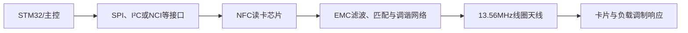

# 2026-10-12 举升机NFC刷卡授权选型与工业开源方案

## 背景、来源时间与全部问题

本篇整理用户指定线程“评估举升机 NFC 芯片选型”。原始讨论发生在2026-10-11约19:40～19:48（Asia/Shanghai），按照用户要求于2026-10-12归档到今天的嵌入式日志。用户贴出的两个Codex链接完全相同，因此按一个来源读取，没有虚构第二个独立线程；今天另一篇4G日志来自当前会话。

用户的实际需求是**刷卡切换主从机，或解锁/取得操作权限**。芯片、卡片类型、认证方式、天线尺寸和最终安装位置都尚未确定；不是已经选定ST25R3916B并完成设计。

本次覆盖的追问依次为：

1. RC522是不是老一代，举升机该选择哪种NFC芯片？
2. 不同读卡器是不是都由谐振射频电路和天线组成，电路是否通用？
3. 是否只是元件数值不同？RC522与更高性能芯片如何比较成本和易用性？
4. 用途只限刷卡切主从和解锁，是否需要高性能器件？
5. 网上有没有已有工业环境应用的开源NFC方案？

[[NFC选型与工业开源方案完整对话|完整对话归档]]保留全部五个提问及助手公开答复。下面同时保留建议变化及其原因，避免将早期推荐误记成最终定案。

## RC522的年代、协议和候选器件

常见“RC522模块”使用MFRC522，是13.56MHz的ISO/IEC 14443A、MIFARE、NTAG读写前端。NXP对具体订购产品MFRC52202HN1当前标注EOL且不推荐新设计，并推荐CLRC663 plus作为新设计方向。旧芯片仍可能买到模块、仍能用来学习，不等于适合长期新产品供货；状态应按完整料号核对。[NXP产品页](https://www.nxp.com/products/rfid-nfc/nfc-hf/nfc-readers/standard-performance-mifare-and-ntag-frontend%3AMFRC52202HN1)

| 方案 | 讨论中的定位 | 开发与选择条件 |
|---|---|---|
| RC522/MFRC522模块 | 入门、桌面验证和已有代码学习 | 成本低、示例多；生命周期、模块质量、卡片协议和实际环境需要核对 |
| MFRC630/CLRC663 plus系列 | NXP新设计替代方向之一 | 协议能力按具体芯片确认；不是把RC522寄存器驱动直接换个芯片名即可 |
| PN532及其模块 | 社区中大量读卡应用和开源项目的硬件基础 | 适合验证功能/交互；模块成熟不等于整机具有工业验证，仍须核对生命周期和实际采购件 |
| PN7160 | 带集成固件、经NCI接口使用的候选 | 固件接口开发方式不同，仍需设计/匹配外部天线 |
| ST25R200 | 面向较精简STM32读卡设计的候选 | 有ST参考板和配套软件；未在讨论中确定它满足最终卡片/认证需求 |
| ST25R3916B | 较高性能的多协议、接收/功率/调谐功能候选 | 需要射频匹配和软件投入，不因设备叫“举升机”就自动必须选择它 |

早期答复因金属、电机等环境因素倾向ST25R3916B，并提出搭配DESFire EV3。用户说明只需刷卡切换主从或解锁后，建议被修正为：**先确认认证要求与安装环境，评估更精简方案，不直接将高性能芯片列为必选。**候选芯片、卡片和库均未最终确认。

## 共通的NFC射频原理与不能照搬的电路

基本结构是：

芯片驱动线圈产生交变磁场，卡片在这个磁场中交换能量/数据，读卡器检测卡片响应。线圈和电容的直观谐振关系为：

$$f_0=\frac{1}{2\pi\sqrt{LC}}$$

这个公式帮助理解电感、电容和谐振频率的关系，但不能单独完成读卡器匹配设计。实际还涉及芯片输出阻抗和驱动方式、天线等效电阻/电感/寄生电容、Q值、场强、滤波、接收分压及协议调制带宽。

RC522、ST25R3916B和PN7160都有“射频芯片＋匹配/调谐网络＋线圈”这些部分，但**芯片间可能连拓扑都不同，并非只换几个电容值**。线圈有机会复用，必须在新芯片的参考条件下测量其参数、重新匹配并验证，旧匹配元件和驱动软件不能默认继续沿用。[ST AN5276](https://www.st.com/resource/en/application_note/an5276-antenna-design-for-st25r391616b-st25r391717b-st25r3918-st25r3919b-and-st25r392020b-devices-stmicroelectronics.pdf)；[NXP PN7160匹配指南](https://www.nxp.com/docs/en/application-note/AN13219.pdf)。

元件选型、去耦、晶体/时钟、接口电平和IRQ/复位需按最终芯片参考设计完成。具体匹配元件、电感、线圈几何尺寸、PCB铜厚、谐振与Q测量数据在本次来源中没有提供，不能补成已验证数值。

## 举升机附近的金属与干扰怎么影响读卡

金属机架和金属外壳会改变线圈等效参数、损耗与读卡距离；电机、开关电源和驱动线路可能引入干扰。把天线摆在哪里、线圈距离金属多远、是否使用铁氧体背衬，往往直接影响最终读卡表现。

因此应按最终外壳和安装位置调试，而不是先在桌面测出距离后就认为现场效果相同。自动天线调谐和动态功率控制能帮助补偿变化，仍须完成天线与安装设计；芯片性能更高不保证读卡距离自动增加。

NFC线圈区域的铜皮和邻近金属要按具体天线参考设计设置净空。这与4G的50Ω馈线需要连续参考地属于不同区域的要求，不能把“板上空白都铺GND”直接应用到NFC线圈中心。有关旧射频笔记中的具体中心抽头、接地和DRC说法，需要回到当前芯片参考设计核对，本次不把那些未验证拓扑作为新板的接线依据。

## 刷卡功能、UID和认证方式

读取UID是取得卡片标识。应用再决定哪个标识可解锁或切换模式，但**UID匹配本身不能等同于防复制的安全认证**。如果操作授权需要防冒用，应评估带密码学认证的卡片与协议；早期讨论以DESFire EV3的AES相互认证及密钥分散作为候选方向。[NXP DESFire EV3](https://www.nxp.com/products/MF3DHx3)

选用支持某种射频协议的芯片，不会自动完成密钥管理、相互认证或权限撤销；这些仍涉及卡片选型、主控软件和密钥管理。反之，功能只是“解锁/切主从”也不能单凭动作简单就认定UID足够，认证等级仍需确认。

建议的职责划分是：读卡器完成寻卡、读卡/认证并给反馈，举升机主控按权限和当前状态决定是否允许动作。NFC作为许可输入，不替代已有急停和安全链。主从切换允许的状态、异常时行为、离线权限和日志是否保留，需要后续设计；这些都未在本次实施。

## 成本比较应如何理解

原对话曾列RC522小模块公开挂价约US$0.5～2.3，以及ST25R3916B单芯片约US$6.34、500颗梯度约US$4.37。这里保留为**来源当时的报价例子**，不是今天重新询价结果，也不是本项目BOM；模块与裸芯片、采购数量、税运和渠道不同，不能直接当作同口径价格表。

选型成本还包括：主控驱动和协议库移植、天线匹配与测量、机械安装、供货周期、板级验证和后续维护。买较便宜模块适合先验证刷卡功能；量产新板则需要同时考虑生命周期、采购件一致性和正式方案要求。

## 查到的开源与公开设计方案

| 方案 | 公开资料与功能 | 本项目可参考内容 | 已知边界 |
|---|---|---|---|
| [Prismo](https://github.com/nu31hackerspace/prismo) | MIT许可，ESP32-C3＋现成PN532模块；有KiCad板、固件、外壳、LED/蜂鸣器和继电器动作 | 刷卡触发反馈与设备动作、板级连接、应用状态机、测试台 | 默认UID授权；项目有真实硬件测试，但本次未找到工业EMC/环境验证证据；其板级设计不等于完整公开PN532裸芯片射频匹配设计 |
| [OpenLatch](https://docs.openlatch.de/) | 开源门禁控制系统，开发用PN532与生产用商业Wiegand读卡器分工 | 控制器离线做权限判断、开发/生产读卡器分开、设备控制架构 | 不能将控制系统开源等同其商业生产读卡器硬件开源 |
| [Adafruit PN532](https://learn.adafruit.com/adafruit-pn532-rfid-nfc/downloads) | 公开原理图、PCB与BSD软件库 | PN532基础电路、接口连接和驱动示例 | 属于开发板参考；本次没有确认其举升机安装验证 |
| [ST25R200与X-NUCLEO-NFC10A1](https://www.st.com/en/nfc/st25r200.html) | 官方评估板、原理图/资料和STM32软件包 | 自制STM32板的基础电路与软件组织 | 评估板不是经过本举升机现场验收的读卡器；源码许可需单独核对 |

对当前“刷卡切主从/解锁”功能，Prismo的应用功能最接近，适合先读其连接、反馈与控制逻辑；OpenLatch适合看系统分工。上述结论是参考价值比较，不是推荐直接搬用其UID权限或部署其后台。

原调研的准确结论是：**在这次检索范围内，没有找到硬件、固件、外壳均开放且同时公开工业环境验证证据的完整方案**。这不等于整个市场或社区不存在，也不应将带硬件测试台的项目说成完全没做测试。

### 公开源码和真正开源许可需要区分

Prismo使用MIT；Adafruit对应软件库有BSD许可。当前归档的 `stm32duino/NFC-RFAL` LICENSE则是ST的SLA0052，含限定与ST NFC器件组合使用及再分发条件。不能因为GitHub上能下载源码，就把它当作无额外限制的MIT/BSD库。

ST不同包、版本和中间件可能有不同许可证，选用时必须读取实际下载包的LICENSE。这里保留来源结论及许可原文，不把某一个RFAL仓库的许可推及所有ST软件。[本次归档的RFAL许可](https://raw.githubusercontent.com/stm32duino/NFC-RFAL/main/LICENSE)。

## 得到的认识、未定事项与下一步

- RC522适合学习和验证已有读卡功能，但当前具体产品生命周期使它不能自动成为新量产板的首选。
- 同类NFC芯片共享线圈与匹配的原理，具体拓扑、参数和软件接口需要重新确认。
- 用户的实际用途支持优先评估精简方案，不必因为举升机有电机和金属结构就强制用ST25R3916B。
- 天线安装条件和卡片认证要求是两条独立选型依据；不能只比较芯片价格或卡号读取是否成功。
- NFC器件、卡片、权限策略、主从切换状态条件、读卡距离和安装位置仍未确定，尚无新板实现或现场验证成果。

建议后续先定义卡片协议和认证等级、实际读卡距离及安装环境；阅读Prismo和OpenLatch确认应用结构；再选择仍适合采购的读卡前端，按它的参考设计画供电、数字接口、匹配网络与线圈。验证要覆盖最终安装位置、电机运行、掉电/重启、重复刷卡与不允许切换的状态；这些均为后续计划。

## 旧外脑中的相关记录

- [[02-嵌入式日志/01-旧外脑/电路/个人知识总结/射频电路/三、MFRC522与13.56MHz读卡前端|MFRC522旧前端笔记]]与[[02-嵌入式日志/01-旧外脑/电路/个人知识总结/射频电路/十、MFRC522线圈天线计算与实测|MFRC522线圈计算与实测]]：记录的是早期MFRC522方案与线圈实例；芯片拓扑和参数不能直接挪用到当前NFC候选。
- [[02-嵌入式日志/01-旧外脑/电路/个人知识总结/射频电路/六、调试、验证与常见错误|射频调试与验证旧笔记]]、[[02-嵌入式日志/01-旧外脑/电路/个人知识总结/射频电路/八、原对话结论校核|旧射频讨论校核记录]]：作为检查来源，具体实现按新选芯片的数据手册和参考设计。

## 附件与关联

- [[附件目录与来源|NFC附件：ST/NXP数据手册与天线指南、Prismo资料与许可证、RFAL许可及原始来源]]
- [[NFC选型与工业开源方案完整对话|五个问题、全部公开答复的对话归档]]
- [原始Codex线程](codex://threads/01a12ac3-a3c5-7422-a946-409670276623)
- [[2026-10-12 移远EG800AK-CN选型与举升机外围电路设计]]
- [[02-嵌入式日志/01-旧外脑/电路/个人知识总结/射频电路/一、射频电路知识总览]]
