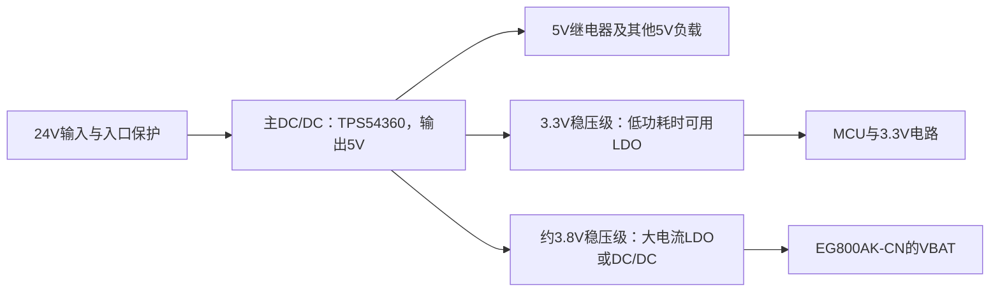

# 2026-10-12 移远EG800AK-CN选型与举升机外围电路设计

## 记录范围与当前状态

今天从移远资料下载和嘉立创EDA导入开始，讨论了EG800AK-CN外围电路、USB与天线阻抗、四层板铺铜，随后重点讨论24V举升机系统中5V继电器、3.3V主控和约3.8V蜂窝模组的多电压供电、成本以及社区和工业产品的实际做法。

用户已报告将AD文件导入嘉立创EDA；截图显示PCB铜箔层数已经从2层改为4层。用户目前决定**暂时继续考虑这颗移远模组**，计划全板集成、无电池、24V输入，同时保留5V继电器供电。没有完成最终原理图、PCB走线、订购料号确认、BOM、打样或现场验证。

本篇按主题保留所有主要追问和解释。早期建议中“3.8V必须另用DC/DC”“1.8W等于模组长期发热”等表述已在下文修正。[[4G模组与电路设计完整对话|完整对话归档]]保留原公开答复；工程使用以本篇的修正和器件原文为准。

## 下载资料、AD文件和嘉立创导入

用户最先问移远下载列表中哪些文件能导入嘉立创。适合提取器件符号和封装的是 `Footprint&Part`；2D尺寸图主要用于核对机械尺寸，3D文件用于绑定外形，硬件手册用于设计说明，参考设计用于参考外围连接。文件名的用途不能代替实际扩展名检查。

归档的V1.3封装ZIP已检查，内容为：

| 文件组 | 文件格式 | 用途 |
|---|---|---|
| Altium Designer | `.SchDoc`、`.PcbDoc` | 器件原理图与PCB封装相关设计 |
| Cadence | `.DSN`、`.brd` | 对应软件的原理图和PCB设计 |
| PADS | `.sch`、`.pcb` | 对应软件的原理图和PCB设计 |
| Revision History | `.xlsx` | 封装资料版本变更记录 |

ZIP里没有STEP/STP模型。这一组是工程/设计文件，并不是单独的 `.SchLib`/`.PcbLib` 库。PCB封装对应 `Quectel_EG800AK-CN_PCB_Footprint_AD_20250802.PcbDoc`；器件符号对应 `Quectel_EG800AK-CN_SCH_Part_AD_20250802.SchDoc`。专业版的格式转换/导入能力依具体文件格式和软件环境而定，二进制转换可能需要相应EDA软件。用户已经完成导入，后续还应核对焊盘编号、间距、阻焊/锡膏、中心接地焊盘和RESERVED引脚，导入成功不等于封装已验收。

资料：[[附件目录与来源|封装ZIP与两份AD文件]]；[专业版格式转换说明](https://prodocs.lceda.cn/cn/import-export/easyeda-pro-format-converter/)。

## 先区分工业级、消费级以及GNSS版本

用户提供了两本不同范围的V1.1手册。两本都已保留原文件；不能因符号或封装名称都写着EG800AK-CN，就认为采购模块必然具有同样温度和GNSS能力。

| 项目 | EG800AK系列V1.1手册 | EG800AK-CN消费级V1.1手册 |
|---|---|---|
| 正常工作温度 | −35～+75℃ | −20～+55℃ |
| 扩展工作温度 | −40～+85℃ | −30～+65℃ |
| VBAT | 3.4～4.3V，典型3.8V | 3.4～4.3V，典型3.8V |
| 电源能力 | 外部电源至少提供1.5A载流能力 | 外部电源至少提供1.5A载流能力 |
| LTE-TDD B41 | 手册列2496～2690MHz | 手册列2535～2675MHz |
| GNSS | CN等型号有可选GNSS章节，须核对实际订购选项 | 引脚2、44、99为RESERVED，没有对应GNSS设计章节 |

扩展温度不应当作全部射频指标始终满足正常工作范围规格的承诺。工业级产品规格V1.3也已归档，其范围明确包含EG800AK-CN。当前仍需确认具体完整订购料号、工业/消费等级、GNSS硬件选项和固件。

手册定位：消费级印刷页13的温度特性、页16～21的引脚；系列印刷页18～23的引脚、页51～54的GNSS。PDF页序号通常比印刷页码多1页，正文引用以页脚编号为准。

## VBAT为什么叫VBAT，为什么不能直接接5V

`VBAT` 是模组主电源脚名称，体现蜂窝模组常见的单节电池电压供电习惯；使用24V固定电源、不装电池也仍向这个引脚提供合适电压。`VCC`是泛用电源网名，实际允许电压由器件手册决定。网名建议使用 `+24V_IN`、`+5V_RELAY`、`+3V3_MCU`、`MODEM_VBAT_3V8`，防止连接时混淆。

EG800AK-CN的VBAT为42、43脚，工作范围3.4～4.3V、典型3.8V。它不要求恰好3.800V；稳压误差、走线压降、纹波和动态跌落共同作用后的引脚电压必须保持在允许范围。这里的关键是供电能力和稳定性，而不是用高精度仪表把电压调到小数点后三位。

`USB_VBUS`为61脚，典型5V，是USB连接检测输入，不能替代VBAT供电。手册里的“5V供电参考电路”是**DC_IN输入5V，经稳压器产生VBAT**，不能把它读成裸模组允许5V主电源输入。

![[09-移远电源参考页.png]]

资料：两本手册的3.4节，消费级印刷页25～26、系列印刷页27～28。

## 24V、5V、3.8V和3.3V的整板供电设计

### 三种输出电压不等于三路DC/DC

用户明确提出继电器需要5V，不能把唯一主电源改成3.8V；全部模块要集成在同一PCB。24V是举升机输入，如果没有另一个需要升降压生成的24V输出，就不增加“24V降压级”。

可以先保留一个主降压，将24V变成5V；3.3V和3.8V作为它的下游支路。下面是**候选电源树**，并非已选定器件值或完成的原理图：

今天实际讨论过以下三种选择：

| 候选结构 | 适用考虑 | 代价与条件 |
|---|---|---|
| 一颗24V→5V DC/DC，后接3.3V LDO与3.8V大电流LDO | 电路简单；允许的平均功耗能通过PCB散热处理 | 两颗LDO都要按各自压差、平均负载、峰值和温度核算 |
| 24V→5V DC/DC，5V→3.8V第二颗DC/DC，3.3V用LDO | 降低模组支路损耗，尤其持续传输或密闭高温环境 | 5V主电源同时承担模组支路输入电流和继电器/主控等负载 |
| 24V→5V与24V→3.8V分别使用降压器，3.3V从5V产生 | 两个大负载支路可分别设计，有利于管理共享5V支路的动态负载 | 多一组高压降压外围和布局；共地后仍可能耦合，不能保证天然无干扰 |

如果没有5V负载，单独24V→3.8V就可以；但这不符合本板已确认的5V继电器需求。当前尚未锁定表中的哪种结构。

### LDO能不能用：修正峰值与平均发热的混淆

LDO是线性稳压器，通常靠外部电阻分压设定可调输出；DC/DC降压器通过开关、电感和反馈转换能量。3.8V可以用可调LDO产生，无须一定购买“固定3.8V”器件。

早期答复用 `(5−3.8)×1.5=1.8W` 排斥LDO过于直接。这个结果代表**持续输出1.5A时的近似损耗**。手册要求至少1.5A供电能力，并不等于模组长期平均电流为1.5A。LDO仍需满足短时高负载、瞬态响应和限流要求，平均散热则主要由平均电流决定：

$$P_{LDO}\approx(V_{in}-V_{out})I_{avg}+V_{in}I_q$$

| 假设平均电流，仅作计算例子 | 5V→3.8V LDO主损耗 |
|---:|---:|
| 200mA | 0.24W |
| 500mA | 0.60W |
| 持续1.5A | 1.80W |

这些不是模组实测平均电流；不能根据短时间、强信号、空闲模式的电流就确定最坏散热。3.3V LDO同理：从5V降到3.3V，主损耗约 `1.7×Iavg`，主控和传感器总平均电流大时也应改用降压器或重新安排电源。

实际参考包括移远EC800K/EG800K设计及ARM Mbed的BG96扩展板使用MIC29302系列大电流LDO生成约3.88V。MIC29302A数据手册已归档，可作为同系列候选资料，但不能把MIC29302WU和MIC29302A的不同订购后缀、封装、电容稳定性条件当作完全相同。此前提到的LT1963A可调版本额定1.5A也能产生3.8V，但余量、封装与散热仍需确认，今天没有选定它。

因此准确结论是：**一颗主DC/DC加两个LDO可以作为候选；3.8V后级是否改成DC/DC，由负载、散热和动态表现决定。**

### TPS54360与TPS54302应该怎样使用

TPS54360工作输入范围4.5～60V，标称连续输出能力3.5A；TPS54302输入范围4.5～28V，标称3A。标称24V落在TPS54302静态范围内，早期说它“不能接24V”过于绝对；准确说法是**举升机现场输入最大值和瞬态尚未确认，不应把28V工作上限的器件直接接上该24V母线作为定案**。把TPS54302用在已稳压的5V之后，是今天讨论过的合理候选，同时要求5V支路负载变化时仍满足它的输入要求。

串联方案中，主5V电源的预算应包含继电器最大同时吸合电流、3.3V支路、其他5V负载，以及3.8V支路的输入功率。以模组支路输出3.8V/1.5A、第二级效率假设90%计算：

$$I_{5V,modem}\approx\frac{3.8\times1.5}{5\times0.9}=1.27A$$

“约1.3A”是这个假设负载下的设计预算例子，不是模组日常平均电流，也不是效率实测结果。采用LDO时输入电流近似输出电流加静态电流，不能使用DC/DC的功率换算。

TI的TPS54360典型参考图是输入8.5～60V、输出5V/3.5A。24V输入在这个示例范围内。若改成3.8V，反馈分压、电感电流纹波、二极管、电容与环路补偿都应重新核算，不能只替换标签。24V入口保护和电容耐压还要按现场最大电压及瞬态确定。

![[10-TPS54360的5V参考电路.png]]

### 成本讨论应保留什么

对话曾引用公开商城报价，将TPS54302粗估为1～2元、TPS54360粗估为6～7元。它们是本次交流中的单芯片价格量级，报价梯度、库存和汇率不完全相同；不作为采购承诺或完整BOM成本。第二路DC/DC还包括电感、电容、反馈器件，非同步器件可能还有续流二极管，以及贴装和PCB面积；大电流LDO也可能需要较大封装与散热铜皮。

用户的成本顾虑保留：不能只说“多几元不重要”，应在满足功能和供电要求的前提下比较总BOM。实际继电器数量、线圈电流、3.3V负载和模组通信占空比均未提供，因此今天没有完整成本核算。

## 外围电路怎样分块画

以下以已导入的器件为核心建立设计清单。参数来自用户的两本手册；GNSS等功能需要具体版本支持。每块的最终元件型号、封装及数值仍须依据参考图、芯片手册和实际连接方式确定。

| 电路块 | 连接与设计重点 |
|---|---|
| 24V输入及5V主电源 | 按实际来源确定保险/限流、反接保护、TVS和输入电容；TPS54360及其功率回路靠近输入/输出电容；SW高电流回路紧凑，反馈线远离SW和电感。 |
| VBAT稳压与去耦 | 42、43脚接约3.8V。按手册使用靠近引脚的低ESR 100µF储能电容，预留100nF、33pF、10pF、3.9pF、1.8pF MLCC位和不小于0603的0Ω调试位；具体装配以参考设计和调试结果为准。 |
| 电源路径与保护 | 手册要求VBAT线宽不小于1.5mm，线越长越要核算压降。VBAT侧建议的TVS为VRWM=4.7V；这个值不是24V入口TVS的选型。TVS实际钳位及响应也要核对，VRWM本身不等于保护电压。 |
| 模组接地 | 所有定义为GND的脚接地，模块下方按手册保持参考地；RESERVED脚按对应版本保留悬空。器件下方、中心焊盘和锡膏分割以移远封装为准。 |
| 开机、关机与复位 | PWRKEY为7脚，RESET_N为15脚，采用开漏/开集驱动。GPIO经基极/栅极驱动使低有效引脚拉低；不向1.8V或VBAT域直接强推3.3V。电源使能控制与PWRKEY控制是两个功能。 |
| 主UART与电平转换 | 模组MAIN_RXD为17脚、MAIN_TXD为18脚。主控TX→电平转换→模块RX，模块TX→电平转换→主控RX。数字域为1.8V，3.3V主控应检查双向电平兼容及掉电回灌；参考器件包括TXS0108E，但最终电路按实际接口确定。 |
| USB调试/升级 | USB_DP 59脚、USB_DM 60脚，90Ω差分；USB_VBUS 61脚是检测输入。保留下载调试和短支线测试点；ESD数据线电容不超过2pF。手册的共模电感和到测试点的默认不贴调试电阻按原图预留。 |
| USB_BOOT与日志接口 | USB_BOOT 82脚及DBG_TXD/RXD保留可访问调试点；强制下载拉低时序按手册的启动条件处理，不在正常启动中误触发。 |
| USIM卡座 | USIM1_DATA/RST/CLK/VDD为11/12/13/14脚，由模组提供1.8/3.0V卡电源。预留ESD、串联调试电阻、33pF滤波和卡座附近100nF；不用检测时USIM_DET 79脚按手册悬空。USIM2仅1.8V，双卡是单待单通。 |
| 4G主天线 | ANT_MAIN为35脚，到天线接口按50Ω特性阻抗走线，预留参考图中的双L型/匹配网络。默认串联0Ω、并联电容不贴的配置需按对应参考图确认；带直流的天线端须按手册设置隔直。 |
| GNSS可选电路 | 版本支持时，ANT_GNSS 2脚接独立GNSS天线，馈线按50Ω；GNSS_VBCKP 44脚的1.8V备用域供电需在GNSS工作前建立，1PPS为99脚。无电池不等于省掉这个工作域供电；有源天线的偏置电源和无源天线匹配分别按原图处理。 |
| 状态输出与可选接口 | NET_STATUS 16脚、STATUS 25脚可供状态指示/主控检测；VDD_EXT 24脚为1.8V、最大50mA，可作逻辑参考/上拉，不作为整板大负载电源。I²C、SPI、LCM、音频等按实际用途、固件方案及引脚复用选择，未使用的功能不默认全部加上。 |
| 5V继电器 | 5V供线圈；MCU经三极管/MOSFET或驱动阵列控制。线圈续流钳位、开关电流回路和去耦按继电器/驱动器要求设计，回流路径避开敏感供电路径。继电器接点负载与线圈供电分开看。 |

主天线ESD器件在这份手册中的建议结电容上限为0.05pF，不能把普通USB/SIM ESD器件直接用于RF口；型号需要按适用频段和RF损耗确认。USB ESD摆放以本模组参考图及外部连接器的放电回路一起核查，不把不同设计中的布局习惯混成固定位置。

### 时序和接口边界

- VBAT稳定至少30ms后，再将PWRKEY拉低至少700ms开机；随后等待状态/串口就绪。
- 正常关机：PWRKEY拉低至少500ms释放，或执行 `AT+QPOWD`；完成模块关机流程后再断VBAT。消费版与系列版时序图的就绪/关机持续时间不完全一致。
- RESET_N低至少300ms用于复位；日常关机流程优先采用手册定义方式。
- 手册要求USB、VBAT、VDD_EXT、PWRKEY、RESET_N、USB_BOOT等调试节点按相应条款保留，测试点支线尽量短。

## 四层板、铺铜、USB与50Ω天线阻抗

### 载流线宽计算和阻抗计算是两个工具

EDA“电路计算器→走线宽度”按电流、铜厚和允许温升估算载流线宽；它不能计算USB的90Ω差分或RF馈线的50Ω特性阻抗。普通网页版所用界面没有展示企业私有部署版的阻抗计算功能，本次改用[嘉立创阻抗计算工具](https://tools.jlc.com/jlcTools/index.html#/impedanceCalculatenew)。界面版本可能变化，实际入口以当前版本为准。

四层板设置在“图层管理器”中将**铜箔层**从2改为4。丝印、阻焊、装配层不算铜层；把EDA设成4层，尚未确认实际制造叠层。

### 阻抗算线宽/线距，长度由布局决定

特性阻抗是传输线横截面与电磁场的属性，不是导线直流电阻。给定目标阻抗，需要实际叠层、材料参数、信号到参考铜层的距离、铜厚、线宽和附近铜皮结构；差分还需要两线间距。反算时可输入已选线宽求阻抗。

用户问的10mil应区分线宽和线长：`1mil=0.0254mm`。USB长度取决于模块和接口的位置；50Ω天线馈线长度取决于模块到天线接口的路径，阻抗计算器不会给出“应该画多长”。线路长度仍影响传播延时、损耗、反射和差分时序，所以不能把“长度不参与此计算”理解成长度对性能完全无关。USB两线同路径、短、对称，控制支线；RF馈线尽量短，参考地连续。未取得具体长度限制时不编造一个固定毫米数。

截图里的两个50Ω结果仅作为当时参数示例：

| 截图条件 | 计算线宽 | 可以应用的前提 |
|---|---:|---|
| JLC04161H-3313A，L1信号、L2参考，单端50Ω | 13.6mil，约0.345mm | 下单叠层、模型、铜厚与铜皮间距等条件全部一致 |
| JLC04161H-7628A，对应截图条件 | 20.3mil，约0.516mm | 同样须对应实际制造参数 |

这两个数都不能直接拿去走USB。USB另按90Ω差分计算 `W1` 与 `S1`。截图中板层4、标称厚1.6mm、外层1oz、内层0.5oz，也不能代替具体叠层编码。早期“默认四层板一般7628”的回答只作一般性参考；最后必须以订单确认的叠层为准，不把第一个计算结果当默认制造值。

如果馈线两侧靠近GND铺铜，就应选择与实际间距一致的共面结构模型；计算时没有考虑的旁边铜皮不能随意挪近而仍沿用原线宽。

![[07-嘉立创阻抗计算与叠层.png]]

### 四层空白处是否都铺GND

可以在合适空白区铺GND并用地过孔连接，但不是四层所有空白处都必须铺铜。候选分层为：L1元器件与信号、L2连续GND参考、L3电源分配及适当GND、L4其他信号与GND。确保USB和RF关键走线参考层连续，不跨地平面裂缝；底层走关键线时也必须重新检查最近参考层是否连续。

重点保留低阻抗回流路径，避免孤立铜岛、细长地颈和功率回流穿过敏感区域。射频参考地、模块下方地铜、RF连接器接地按手册处理；开关电源SW区控制面积，不把它做成巨大辐射铜皮。

**射频馈线和天线辐射区域要区分**：4G/GNSS馈线需要合适连续参考地；天线本体净空按所选天线说明。NFC的13.56MHz线圈及其中心磁通区域另按NFC天线规则做净空，不能把“四层空白都铺GND”的习惯套过去。本日志与今天归档的NFC日志互相对应这一点。

## 4G加北斗/GPS的选型讨论

用户考虑过换一种能直接用5V或3.3V、同时带4G和定位的移远模组，目的是简化板上电源。筛选得到的重点是：**裸模组与已带电源转换的核心板必须区分**。本次查到的几款裸模组仍采用电池电压级别的VBAT；工作范围含3.3V，并不保证普通小电流MCU的3.3V LDO能承担蜂窝发射负载。

| 候选 | 定位能力与确认条件 | 供电信息 | 本次结论 |
|---|---|---|---|
| EG800AK-CN | GNSS可选。消费级这本手册不提供GNSS；某些 `EG800AKCN_11LG` 文档说明仅北斗，其他系列说明列多星系，必须以完整料号为准 | 3.4～4.3V，典型3.8V | 当前暂时保留这个候选，不根据系列名保证GPS或北斗已装入 |
| EG800K-CN | 官方资料列GPS、BDS、GLONASS | 3.4～4.3V，典型3.8V | 定位需求的候选；不会消除3.8V电源 |
| EC800G-CN | GNSS可选，官方介绍列GPS/BDS/GLONASS/Galileo | 3.3～4.3V，典型3.8V | 3.3V在范围下边界，须给误差、压降和动态跌落留余量；不能只因“3.3V兼容”就认为更省事 |

CN系列手册列GNSS默认星系信息，并说明GNSS与辅助UART不可同时使用。GNSS一般需独立天线、适当偏置/匹配，默认关闭时通过对应AT功能启用。手册/固件/产品规格的适用范围可能不同，本次没有锁定GNSS版本。

举升机若固定安装在车间，登记安装地点可以满足站点管理；若会运输、移动或需要位置追踪，GNSS更有价值。室内、金属遮挡或地下车库定位条件需要另查，不能根据模组“支持GPS”承诺现场一定能定位。这些是选型思路，用户尚未取消定位需求。

## 社区、网上硬件设计者和工业成品实际怎样做

用户反复强调想看现实电路，而不只是按规格继续堆选型。查到的公开实例说明LDO与DC/DC都有应用，不能用某一块开发板概括整个社区的数量偏好。

| 公开实例 | 已能确认的信息 | 适用边界 |
|---|---|---|
| [GPD Pocket 3 cellular module](https://github.com/themainframe/p3-cellular-module) | EC25；公开KiCad原理图、PCB和BOM；四层板。电源页用AP62301降压，从VBUS生成3.8V | 其上游电脑已经提供USB侧电源，板内没有另做24V→5V；作者称仍是原型，不能等同工业现场认证 |
| [ARM Mbed BG96扩展板](https://github.com/ARMmbed/reference-design-RD2166/blob/master/Hardware/Example_Implementation/Module_Expansion_Board/MEB-Quectel-BG96-v1.2.0.sch) | MIC29302WU大电流LDO；反馈电阻100k/47k产生约3.88V，输出分到模组基带/RF域 | BG96与EG800AK不是同一模组，只参考供电思路；其工作网络制式与本项目候选不同 |
| [移远EC800K/EG800K参考设计](https://developer.quectel.com/wp-content/uploads/2024/09/Quectel_EC800KEG800K_Series_QuecOpen_Reference_Design_V1.0-1.pdf) | 高压输入先DC/DC到5V，再经MIC29302等产生3.8V及其他低压；该参考按2A模组供电能力设计 | 是相近器件的官方参考，不替代EG800AK的具体手册 |
| [LILYGO T-SIM-DC-Shield](https://github.com/Xinyuan-LilyGO/LilyGo-Modem-Series/blob/main/docs/en/shield/t-sim-dc-shield/README.MD) | 扩展板7～36V输入，提供最高3A的5V，再连接底板；3.3V由底板提供 | 体现高压入口电源与底板电源分级，不证明所有板子都用同一种模组稳压器 |
| [SBCShop EG25-G breakout](https://github.com/sbcshop/Quectel_EG25-G_Module_Breakout_Hardware) | 作者公开原理图/板视图，注明MIT许可 | 可参考核心板组织和接口，不按产品外部接口电压推断裸模组VBAT电压 |

因此本次得到的现实理解是：上游高压用降压器，低电压支路按功率选LDO或DC/DC；USB输入开发板看似少一级，是因为前级电源在板外。工业产品在同一板上有5V、3.3V和约3.8V三种电压，并不罕见。

### 有实际工业产品采用这些移远模组

- 银尔达 [M800AK-B2](https://www.yinerda.com/productinfo/151150.html?templateId=1133605) 厂家明确介绍为基于EG800AK的工业级单TTL串口DTU，用于设备控制、状态检测与传感器采集，核心板输入5～12V、温度−35～+75℃。这证明已有以EG800AK为核心的工业通信产品；不代表当前未知完整料号的所有模块都具备同样等级。
- Teltonika的TRB140网关型号清单列EC25-EU/AU/J，研华工业路由器模组清单也列多种EC25与EG25。商业成品的高压/5V输入由厂家PCB处理，不能将裸模组供电直接提高到5V。[Teltonika原厂清单](https://wiki.teltonika-networks.com/images/c/ce/TAC_TeltonikaNetworks_2025.02.10.pdf)；[研华模组清单](https://icr.advantech.com/resources/faq/detail/current-cellular-modules)。

## 本次修正、待确认项与下一步

| 容易误记的旧说法 | 本次保留的准确结论 |
|---|---|
| 模组必须精确3.8V | 3.8V为典型目标，实际脚电压满足规定范围与动态要求 |
| VBAT表示必须有电池 | 无电池仍向VBAT提供合适稳压电源 |
| 5V输入参考图代表裸模组5V供电 | 5V是前级输入，稳压器输出才接VBAT |
| 3.8V一定要第二颗DC/DC | 大电流LDO与DC/DC都可候选；按峰值能力、平均损耗和散热选择 |
| 模组电源至少1.5A，所以LDO长期发热1.8W | 电流能力与平均电流不同；1.8W对应持续1.5A假设 |
| TPS54302静态绝不能接24V | 24V在静态范围内，但未知工业母线瞬态且上限28V，当前不采用未经核算的直接接入方案 |
| 四层空白处都必须GND铺铜 | 保护连续回流路径，并遵守SW区、天线净空等具体要求 |
| 13.6mil是四层板通用线宽 | 仅特定叠层/模型的50Ω结果，不用于USB，不替代下单参数 |
| 线长与信号无关 | 不参与当前横截面阻抗求解，但影响延时、损耗、反射与时序 |
| 系列名称带GNSS即购买件有GNSS | 按工业/消费等级、完整料号、硬件选项和固件确认 |

尚待用户/实际设计确认：继电器数量与同时吸合电流、全部3.3V负载、4G上报频率与持续传输需求、24V来源和瞬态范围、机箱温度与散热空间、主控型号、主控通信走UART还是USB、实际GNSS料号、天线类型和安装位置、最终嘉立创叠层。

建议下一步按电源、模块接口、SIM、USB调试、主天线及可选GNSS、继电器驱动分别完成原理图；先做负载预算再选择3.8V后级LDO或DC/DC。确定具体叠层后计算90Ω/50Ω，完成封装/引脚核对和设计检查。弱信号持续通信、继电器切换、电源最低/最高值及温度条件下的验证应作为后续工作，今天未进行这些硬件操作。

## 旧外脑中的相关记录

- [[02-嵌入式日志/01-旧外脑/电路/AI原理图总结/高昌/00、当前控制板原理图总览|原举升机控制板原理图总览]]：旧图中TPS54360将24V转5V、TPS54302将5V转3.3V，图纸解读适用于该参考板。
- [[02-嵌入式日志/01-旧外脑/电路/个人知识总结/高昌/电源与保护/LDO线性稳压器|旧LDO笔记]]、[[02-嵌入式日志/01-旧外脑/电路/个人知识总结/高昌/开关电源/TPS54360引脚与反馈调压入门|TPS54360学习笔记]]：提供基础解释，器件方案仍按本篇EG800AK和实际负载重新核对。
- [[02-嵌入式日志/01-旧外脑/电路/个人知识总结/高昌/通信与数据存储/4G模组供电与通信|Air780E供电与通信旧记录]]：对象是Air780E，与EG800AK引脚和供电要求不同，仅作旧项目经验。
- [[02-嵌入式日志/01-旧外脑/电路/个人知识总结/射频电路/五、四层PCB布局布线与阻抗|旧四层PCB与阻抗学习记录]]。

## 附件、原文与关联阅读

- [[附件目录与来源|完整附件清单：原始移远资料、TI/ADI/Microchip数据手册、公开电源设计与截图]]
- [[4G模组与电路设计完整对话|本线程公开文字完整归档]]
- [[2026-10-12 举升机NFC刷卡授权选型与工业开源方案|同日归档的NFC讨论]]
- [[02-嵌入式日志/01-旧外脑/电路/个人知识总结/高昌/开关电源/TPS54360引脚与反馈调压入门]]
- [移远EG800AK开发者资料](https://developer.quectel.com/modules-cat/eg800ak%E7%B3%BB%E5%88%97)
- [EG800AKCN_11LG等型号GNSS说明](https://python.quectel.com/doc/quecpython/API_reference/en/gnsslib/quecgnss.html)
- [嘉立创阻抗叠层说明](https://jlcpcb.com/impedance)
- [TI TPS54360](https://www.ti.com/product/TPS54360)；[TI TPS54302](https://www.ti.com/product/TPS54302)
