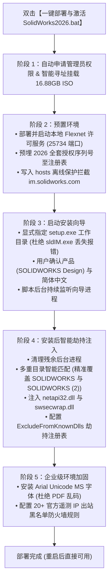

# 01、SolidWorks 2026 企业级无感自动化部署与激活全流程

> 先用一句人话说清楚：利用批处理与 PowerShell 深度整合脚本，将 16.88GB 庞大的 SolidWorks 2026 SP4.1 变为无需手动翻找序列号、无需繁琐复制破解 DLL、无惧官方网络封杀的一键式标准化交付流程。

## 先记住

- **架构核心**：安装分为三大部分——底层 `Flexnet Server` 许可服务守护进程（25734 端口）、官方原版光盘安装向导、以及基于 `netapi32.dll` 的 Windows DLL 劫持注入补丁。
- **自动化核心**：通过注册表预埋 2026 序列号与安装前离线保护，解决官方服务器在线隐藏主程序的暗坑。
- **交付包位置**：桌面专用独立分发包：`SOLIDWORKS Design 2026部署\`，内含全自动批处理引擎与急救补丁，可随拷随用。

## 它在系统中做什么

传统 SolidWorks 部署存在四大痛点：
1. **安装向导依赖在线校验**：官方服务器探测到未订阅序列号后会隐藏主程序，导致用户装完只剩 `eDrawings`；
2. **多层激活工具易漏步**：需手动启动服务、导入注册表、手动替换文件，人工出错率极高；
3. **版本迭代与多目录命名冲突**：二次安装或重装常被系统安装到 `SOLIDWORKS (2)` 目录，导致传统激活器覆盖失效；
4. **缺少配套补丁**：导出 PDF 中文字体报错、官方遥测后台反查盗版等问题频发。

本流程通过一键批处理与 PowerShell 引擎实现**安装前预制、安装中监控、安装后自动劫持注入与安全防护**的端到端闭环。

## 工作过程

### 阶段一：环境与安装介质检测
1. **自动提权**：检测当前是否具备 Administrator 凭据，未提权则通过 `Start-Process cmd.exe ... -Verb RunAs` 请求 Windows UAC 授权。
2. **多源镜像寻址**：
   - 优先检查当前电脑是否已挂载 `setup.exe` 的光盘驱动器；
   - 其次检测当前工具包根目录下的 `SolidWorks.2026.SP4.1.Premium.DVD.iso`；
   - 最后回退到公司内部局域网共享路径 `\\gzdz0099\DS.SolidWorks.2026.SP4.1.Premium-SSQ\...` 并调用 `Mount-DiskImage` 自动挂载为本地虚拟驱动器。

### 阶段二：许可服务配置与离线保护
1. **Flexnet 服务部署**：
   - 彻底卸载清理旧版 `SolidWorks Flexnet Server` 服务与残留；
   - 将 `SolidWorks_Flexnet_Server` 部署至本地 `C:\SolidWorks_Flexnet_Server`；
   - 调用 `installs.exe` 注册服务并使用 `net start` 启动服务，监听本地 `25734` 端口。
2. **序列号预埋**：
   - 将 `sw2026_network_serials_licensing.reg` 静默导入 `HKLM\SOFTWARE\SolidWorks\Licenses\Serial Numbers`。安装向导拉起时各模块序列号已被自动填满。
3. **离线保护屏蔽**：
   - 向 `C:\Windows\System32\drivers\etc\hosts` 写入 `127.0.0.1 im.solidworks.com` 等规则，防止向导在线联网检测授权状态而下发隐藏主程序指令。

### 阶段三：调用官方向导安装
1. **工作目录锁定**：
   - 显式通过 `-WorkingDirectory (Split-Path $setupPath)` 调起 `setup.exe`，避免因继承 `System32` 工作目录导致 `sldIM.exe could not be found` 致命报错。
2. **关键产品勾选**：
   - **必选**：`SOLIDWORKS Design (7.6 GB)` 核心建模主程序；
   - **语言**：展开 `SOLIDWORKS Design Languages`，勾选 `Chinese Simplified`（简体中文）；
   - **避坑**：不要勾选 `SOLIDWORKS Electrical`（避免引入庞大且易崩溃的 SQL Server 实例）；
   - **端口确认**：确认许可证服务器为 `25734@localhost`。
3. **向导生命周期监听**：脚本在后台循环检测 `sldworks.exe` 的生成并等待向导进程完全退出。

### 阶段四：深度破解补丁注入
1. **多重目录智能覆盖**：
   - 遍历 `C:\Program Files\SOLIDWORKS Corp` 下所有以 `SOLIDWORKS` 开头的目录（自适应兼容 `SOLIDWORKS`、`SOLIDWORKS (2)`、`SOLIDWORKS (3)` 等）；
   - 覆盖核心补丁文件：`netapi32.dll`、`swsecwrap.dll`、`RTLibraryManager.exe`、`SldToolboxConfigure.exe` 及 `ThemeEditor\`；
   - 覆盖 `SOLIDWORKS Visualize*` 与 `eDrawings\` 对应的劫持 DLL。
2. **注册表劫持声明**：
   - 导入 `SolidSQUADLoaderEnabler.reg`，向 `HKLM\SYSTEM\CurrentControlSet\Control\Session Manager` 写入 `ExcludeFromKnownDlls`（包含 `netapi32.dll`），允许程序目录下的伪造 DLL 优先于系统已知 DLL 被加载。
3. **FLEXlm 注册表修正**：
   - 强制设置 `HKLM\SOFTWARE\FLEXlm License Manager` 的 `SW_D_LICENSE_FILE` 为 `25734@localhost`。

### 阶段五：字体与网络防护加固
1. **安装中文字体**：将 `arial unicode ms.ttf` 静默复制至 `C:\Windows\Fonts` 并注册，解决 SolidWorks 导出 PDF 图纸时的乱码与缺失报错。
2. **出站安全防火墙**：通过 `netsh advfirewall` 添加出站黑名单规则，拦截 20 余个 SolidWorks 官方数据上报与防盗版遥测 IP。

## 关键核心配置与技术参数

| 配置项 | 推荐值 / 路径 | 核心作用 |
|---|---|---|
| **许可服务端口** | `25734@localhost` | 本地 Flexnet (lmgrd) 守护进程通信端口 |
| **许可文件位置** | `C:\SolidWorks_Flexnet_Server\sw_d_SSQ.lic` | 包含所有 2026 高级模块授权特性的本地 License |
| **DLL 劫持清单** | `netapi32.dll`, `swsecwrap.dll` | 绕过主程序对 Flexnet License 签名的密码学校验 |
| **注册表劫持项** | `ExcludeFromKnownDlls` | 确保 Windows 优先加载软件根目录下的 netapi32.dll |
| **主程序核心组件** | `SOLIDWORKS Design (7.6 GB)` | 3D CAD 参数化建模与工程图核心 |
| **PDF 字体补丁** | `Arial Unicode MS (TrueType)` | 修复绘图转 PDF 时缺少 Unicode 矢量的通病 |

## 常见误解与避坑

- **误解 1：安装包只要下完 setup.exe 就能点下一步装完全部**  
  *真相*：安装向导默认会在联网状态下向达索服务器校验，若检测到盗版/未订阅序列号，会静默**取消勾选并隐藏** SOLIDWORKS 主程序。必须配合离线 hosts 阻断或在向导中点击 `Select different packages or products` 强制唤出。
- **误解 2：双击批处理闪退是系统缺少组件**  
  *真相*：Windows CMD 默认以 GBK 编码解析，若批处理文件保存为 UTF-8 会因编码错乱引发语法崩溃；脚本必须转存为 ANSI/GBK 编码并配置 `/k` 驻留。
- **误解 3：把破解 DLL 拷进 `Program Files\SOLIDWORKS Corp\SOLIDWORKS` 就万事大吉**  
  *真相*：如果此前曾装过辅助工具，安装向导会自增后缀为 `SOLIDWORKS (2)`。如果补丁放错目录，启动必定报 `(-8,544,0)`。

## 部署验证检查清单

- [ ] `SolidWorks Flexnet Server` 服务处于 Running 状态，本地 25734 端口处于 Listen 状态。
- [ ] `C:\Program Files\SOLIDWORKS Corp\SOLIDWORKS (x)\netapi32.dll` 补丁文件已存在。
- [ ] 注册表 `ExcludeFromKnownDlls` 已包含 `netapi32.dll`。
- [ ] 注册表 `FLEXlm License Manager` 中的 `SW_D_LICENSE_FILE` 指向 `25734@localhost`。
- [ ] 启动 SolidWorks 2026 能正常进入红黑主界面，无任何许可阻断弹窗。
- [ ] 打开零件、装配体、工程图功能完备，导出 PDF 正常。

## 关联笔记

[[04-工具/CAD与机械设计/00、CAD与机械设计工具总览]]、[[04-工具/CAD与机械设计/02、SolidWorks 常见激活报错与避坑排错手册]]、[[04-工具/00、工具总览]]
