# ShareX

> 一句话说明：Windows 平台上一款完全免费、开源、无广告且功能极强的截图、屏幕录制、图像标注与自动化工作流工具。

## 先记住

- **核心定位不是单纯的截图软件，而是“自动化任务流水线引擎”**：从屏幕捕获、添加阴影/水印、图像编辑标注、自动重命名保存本地、自动上传图床，到生成 Markdown 链接并写入剪贴板，全过程均可自动化完成。
- **开源、轻量且隐私可控**：采用 GPLv3 开源协议，纯本地优先，无任何内置广告与强制联网分析，所有数据完全掌握在自己手中。
- **全功能内置工具箱**：自带离线/在线 OCR 屏幕文字识别、屏幕拾色器、屏幕标尺、贴图置顶（Pin to screen）、长页面滚动截屏、二维码生成/解析以及基于 FFmpeg 的 GIF/MP4 屏幕录制，能直接替代 4~5 个散落小工具。
- **初次上手必须做安全检查**：默认设置中务必检查并关闭“截图后上传到公共图床”的动作，防止包含代码凭据、个人隐私或工程图纸的截图被意外推送到公网。

---

## 它在系统中做什么

在日常开发、嵌入式硬件调试与 Obsidian 知识管理中，ShareX 充当着**桌面视觉信息捕获与资产流转的枢纽**：

```mermaid
flowchart LR
    subgraph INPUT["输入来源"]
        A1["区域 / 窗口 / 屏幕"]
        A2["长滚动网页 / 代码"]
        A3["屏幕动态操作 (录屏)"]
        A4["图像文字 (OCR)"]
    end

    subgraph SHAREX["ShareX 自动化处理引擎"]
        B1["捕获 (Capture)"]
        B2["任务后处理 (After Capture)"]
        B3["目标分发 (Destinations)"]
        B4["上传后动作 (After Upload)"]
    end

    subgraph OUTPUT["输出流向"]
        C1["剪贴板图片 / 富文本"]
        C2["本地附件库 (按时间戳归档)"]
        C3["桌面悬浮贴图 (Pin)"]
        C4["Obsidian Markdown 链接"]
    end

    INPUT --> SHAREX
    SHAREX --> OUTPUT
```



- **解决的核心痛点**：
  1. **系统原生截图能力单薄**：Windows 截图工具缺乏高效的序号标记、长截图以及高级马赛克功能。
  2. **第三方商业截图软件弊端**：普遍存在商业广告、强制联网云同步、功能付费锁死或隐私泄露风险。
  3. **知识库插图与录屏流程繁琐**：通常需要“截取 -> 存到桌面 -> 手动重命名 -> 拖进 Obsidian -> 调整大小”，而 ShareX 可将这一链路压缩为一次热键按键。

---

## 工作过程与核心流水线机制

ShareX 最强大的特性在于其清晰的**四阶段任务流水线（Pipeline）**：

```text
[1. 捕获 (Capture)] 
        ↓
[2. 截图后任务 (After Capture Tasks)] 
        ↓
[3. 目标上传与存储 (Destinations)] 
        ↓
[4. 上传后任务 (After Upload Tasks)]
```

### 1. 捕获阶段 (Capture)
触发指定热键或菜单项，选择捕获目标：
- **区域截图 (Region)**：支持放大镜辅助、十字辅助线、自动吸附窗口边缘，像素级精准选区。
- **活动窗口 / 屏幕 (Window / Monitor)**：直接抓取指定程序窗口或多屏中的单屏。
- **滚动截屏 (Scrolling capture)**：对长网页、长日志输出、超长代码窗口进行自动滚动截取并拼合。
- **屏幕录制 (Screen recording)**：框选区域后直接录制为 MP4 视频或高质量轻量 GIF 动图。

### 2. 截图后任务 (After Capture Tasks)
当图像被捕获后，流水线按勾选项自动执行一系列动作：
- 打开内置图像编辑器（供手动标注）。
- 自动为图片添加边框、阴影或水印。
- 自动将图像复制到系统剪贴板。
- 自动按规则保存到本地硬盘。
- 将图像送入图床上传队列（如已配置）。
- 自动识别图像中的二维码或执行 OCR 文本提取。

### 3. 目标上传与存储 (Destinations)
支持将捕获的内容分发至 80+ 种目标服务：
- **本地存储**：指定本地或局域网目录，按日期、软件名、分辨率等变量组织文件夹。
- **自定义图床 (Custom Uploader)**：支持配置任意 HTTP POST/GET 接口（如私有 Lsky Pro、SM.MS、Chevereto、Alist、自建图床服务）。
- **云存储与网盘**：GitHub Gist、AWS S3、Cloudflare R2、Google Drive、OneDrive、FTP/SFTP 等。

### 4. 上传后任务 (After Upload Tasks)
上传完成后触发最终收尾工作：
- 自动将生成的图片 URL 复制到剪贴板。
- 自动将 URL 包装为 Markdown 格式（如 ``）后存入剪贴板。
- 自动调用短链接服务或弹出系统通知。

---

## 核心功能与模块解析

| 功能模块 | 包含能力 | 实际使用场景与价值 |
|---|---|---|
| **截图与选区 (Capture)** | 区域、窗口、显示器、滚动长截屏、光标保留 | 放大镜与边缘吸附极大提升截图精度；滚动截屏适合保存长篇技术文档与串口历史输出。 |
| **图像编辑与标注 (Editor)** | 步骤序号球 (Step)、箭头、矩形、文字、高亮、模糊 (Blur)、马赛克 (Pixelate) | **步骤序号球**点击自动递增数字（1, 2, 3...），做软件教程或标注电路板引脚非常方便；马赛克与模糊保护隐私。 |
| **屏幕录制 (Recorder)** | GIF 动图录制、MP4 视频录制、WebM 录制 | 依赖内嵌的 FFmpeg 引擎。录制高帧率小体积 GIF，极其适合用于 GitHub PR 演示、Bug 复现报告与技术文档。 |
| **屏幕效率工具 (Tools)** | OCR 文字识别、拾色器 (Color Picker)、标尺 (Ruler)、贴图置顶 (Pin) | **OCR** 快速提取不可复制界面（如弹窗报错、原理图图片）中的文字与十六进制代码；**贴图置顶**相当于悬浮参考图；**拾色器**直接提取颜色 HEX/RGB。 |
| **工作流自定义 (Workflows)** | 独立快捷键绑定专属任务流 | 允许为不同快捷键绑定不同流水线（例如：键位 A 截图标注存剪贴板；键位 B 滚动截屏；键位 C 直接 OCR 拷文字）。 |

---

## 与 Obsidian 笔记联动工作流

在知识管理中，ShareX 主要有两种经典搭配模式：

### 模式一：纯本地附件流（推荐，离线安全）
1. **配置保存路径**：在 ShareX 的【应用程序设置 -> 路径】中，设置截图保存目录为 Obsidian 仓库中的附件目录，或统一的外部本地媒体库。
2. **设置文件命名**：在【任务设置 -> 文件命名】中，配置命名模板为时间戳，例如 `%y-%mo-%d_%h-%mi-%s`。
3. **流水线动作**：
   - 勾选【打开图像编辑器】（需要标注时）。
   - 勾选【复制图像到剪贴板】。
   - 勾选【保存图像到文件】。
   - **取消勾选【上传图片到主机】**。
4. **笔记中引用**：截图标注完成后，回到 Obsidian 笔记中直接按 `Ctrl + V`，图像立即作为标准本地附件插入，图片文件规范归档，绝不丢失。

### 模式二：图床外链流（适合跨端多设备同步、控制库体积）
1. 在 ShareX 的【目标设置 -> 自定义上传目标】中，配置个人自建图床（如 Cloudflare R2 / S3 / 兰空图床）。
2. 在【任务设置 -> 上传】中，配置剪贴板复制格式为 Markdown 语法：
   ```text
   
   ```
3. 截图完成后，ShareX 自动完成上传并将 `` 送入剪贴板，在 Obsidian 中直接粘贴即可，无缝跨多设备预览，不膨胀本地 Git 仓库体积。

---

## 常见误区与使用建议

- **误区一：以为这是开箱即用的傻瓜式单功能工具**
  - *实际情况*：ShareX 的设置项与功能极度繁复（包含数以百计的选项）。初学者容易被复杂的菜单劝退。**使用建议**：初学者只需关注主界面左侧的【截图后任务】以及【热键设置】，其余高级选项保持默认即可。
- **误区二：忽视“截图后任务”的默认上传行为**
  - *风险说明*：部分安装包初次启动时，若默认勾选了“上传图片”，截图后可能会自动推送到 Imgur 等境外公开图床。如果截图中包含密码、Token、公司电路图或个人聊天记录，会产生重大安全隐患。**必须第一时间关闭公共上传**。
- **误区三：录屏时提示缺少编码器或无法录制**
  - *排查说明*：ShareX 的录屏引擎依赖开源的多媒体工具 FFmpeg。初次点击【屏幕录制 (GIF)】时，软件会弹窗询问是否下载 FFmpeg，点击“是”让其自动下载并配置即可，无需手动配置环境变量。

---

## 推荐初始配置与检查清单

- [ ] **安全基线**：在主界面左侧菜单中，点击【截图后任务】，**确保取消勾选【上传图片到主机】**；仅保留【打开图像编辑器】（或【复制图像到剪贴板】）与【保存图像到文件】。
- [ ] **常用全局快捷键设置**（在【快捷键设置】中配置）：
  - `Ctrl + Shift + A` 或 `Ctrl + PrintScreen`：区域截屏（带标注）。
  - `Alt + PrintScreen`：活动窗口截屏。
  - `Shift + PrintScreen`：屏幕录制 (GIF)。
  - 自定义快捷键（如 `Ctrl + Shift + C`）：屏幕拾色器。
  - 自定义快捷键（如 `Ctrl + Shift + O`）：屏幕 OCR 识别文本。
- [ ] **文件命名规范**：进入【任务设置 -> 文件命名】，设置主命名模式为 `%y-%mo-%d_%h-%mi-%s`，避免带特殊符号导致 Obsidian 跨平台链接解析异常。
- [ ] **录屏扩展准备**：手动触发一次【屏幕录制 (GIF)】，完成 FFmpeg 自动下载安装。

---

## 关联笔记

- [[04-工具/截图与录屏/00、截图与录屏工具总览|截图与录屏工具总览]]
- [[00、知识库总览]]
