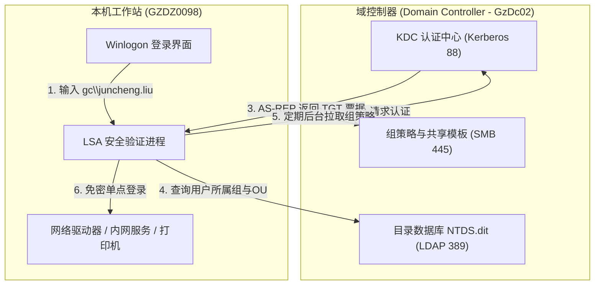

# 微软域与 Active Directory 域服务

> 一句话说明：微软企业级集中目录服务与身份访问控制体系，通过域控制器（Domain Controller）统管网络内所有计算机、员工账号与安全组策略。

> [!NOTE] 术语识别说明
> 提示词中提及的 **“WILE Glynn”** 为语音输入/识别软件将中文 **“域管理”**（拼音：`yù guǎn lǐ`）误转写生成的字符。在 Windows 运维中，它对应的正是通过控制台 `dsa.msc` 启动的 **“Active Directory 用户和计算机”（Active Directory Users and Computers，即微软域管理工具）**。

---

## 先记住

- **区别于传统单机工作组（Workgroup）**：工作组电脑是“各自为政”，账号密码分散保存在每台电脑本地的 SAM 数据库中；而**加入微软域（Domain）后是“中央集权”**，所有账号凭据、权限、安全策略统一存储在域控制器的 `NTDS.dit` 目录数据库中。
- **三大核心通信基石**：
  1. **DNS 服务定位**：客户端通过 DNS 查询 SRV 记录（如 `_ldap._tcp.dc._msdcs.corp.gaochang.com`）自动发现并连接最近的域控制器。
  2. **LDAP 目录访问**：通过轻量目录访问协议（LDAP/LDAPS，端口 389/636）进行用户属性、组织架构（OU）及计算机对象的层次化查询。
  3. **Kerberos v5 安全认证**：摒弃明文传输，基于票据分发机制（AS 认证 ➔ 获取 TGT 票据 ➔ TGS 签发服务票据），实现全企业内网高安全性的**单点登录（SSO）**。
- **组策略（GPO）集中管控**：管理员只需在域控上一键下发 GPO，所有加入域的客户端在开机或后台刷新时就会自动应用统一的壁纸、密码复杂度、禁止插U盘、防火墙端口策略或证书。
- **本机实际运行状态实证**：
  - **当前加入的域**：`corp.gaochang.com`（`PartOfDomain: True`）。
  - **计算机名**：`GZDZ0098`。
  - **当前通信域控 (DC)**：`\\GzDc02.corp.gaochang.com`（内网 IP：`10.1.3.32`）。
  - **当前登录用户 FQDN**：`CN=刘峻丞 juncheng.liu, OU=21技术部, OU=广州用户, OU=101-广州, OU=1-用户及电脑Users, OU=GC, DC=corp, DC=gaochang, DC=com`。

---

## 它在系统中做什么

在企业 IT 治理中，微软域充当着**核心身份与设备信任中枢**：



- **解决的核心痛点**：
  1. **海量终端账号难以管理**：员工离职只需在域控禁用该账号，其名下所有域内电脑、文件服务器权限立即全部失效。
  2. **内网权限各自为政**：通过统一的组织单元（OU）和安全组，统一赋予共享文件夹、内网系统、打印机及 RDP 远程登录权限。
  3. **终端安全基线无法把控**：借助组策略自动更新系统补丁、强制定时锁屏、分发内部 CA 根证书。

---

## 核心工作过程与认证机制

### 1. 登录与身份验证流程 (Kerberos v5)
1. **客户端定位域控**：计算机开机后，通过配置的内部 DNS 服务器查询 `_ldap._tcp.dc._msdcs.corp.gaochang.com` 记录，拿到域控 IP（`10.1.3.32`）。
2. **认证请求 (AS-REQ)**：用户在登录界面输入账号密码，客户端 LSA 进程用密码哈希加密时间戳，向域控 KDC（端口 88）发送认证请求。
3. **获取 TGT (AS-REP)**：域控验证哈希无误后，返回使用 KDC 私钥加密的 **TGT（Ticket Granting Ticket，票据授予票据）**。
4. **获取服务票据 (TGS-REQ/REP)**：当用户访问内网共享或远程桌面时，用 TGT 向 KDC 申请对应目标服务器的**服务票据（Service Ticket）**，随后直接出示票据登录，全程密码绝不在网络上明文流转。

### 2. 域管理工具 (dsa.msc / RSAT)
- 在 Windows 客户端上，系统管理员或具备授权的技术人员常通过命令 `dsa.msc` 启动 **Active Directory 用户和计算机管理控制台**。
- **作用**：直观查看和维护企业目录树，管理各个部门（OU）的人员账号、重置密码、将新计算机加入对应组织单元、维护安全组分配等。

---

## 关键协议、端口与参数

| 协议 / 机制 | 常用端口 | 在微软域中的具体作用 |
|---|---|---|
| **DNS** | UDP/TCP 53 | 解析域名与 SRV 定位记录，是客户端找到域控制器的前提。 |
| **Kerberos v5** | TCP/UDP 88 | 域环境的核心认证协议，生成与校验身份票据，防重放攻击。 |
| **LDAP / LDAPS** | TCP 389 / 636 | 查询和修改 Active Directory 目录树中的用户、组和电脑属性。 |
| **SMB / CIFS** | TCP 445 | 用于下载 SYSVOL 中的组策略模板脚本以及内网文件共享。 |
| **RPC / NetBIOS** | TCP 135 及动态高端口 | 域控制器间复制通信及远程管理调用。 |
| **MS-SNTP** | UDP 123 | 域内时间同步服务（Kerberos 要求客户端与域控时间误差不得超过 5 分钟）。 |

---

## 常见误区与使用建议

- **误区一：以为微软域是一个需要单独下载安装的“第三方软件”**
  - *正确理解*：微软域是 Windows 系统的**底层核心原生网络架构**。只要安装的是 Windows 专业版/企业版，系统就已经内嵌了完整的域客户端组件；企业只需架设 Windows Server 作为域控制器，客户端点击“系统设置 ➔ 加入域”即可接入。
- **误区二：域账号登录不了就是“电脑坏了”**
  - *正确理解*：域认证极度依赖**网络与内部 DNS**。如果内网网线脱落、或者 DNS 设置被手动篡改导致无法解析到 `GzDc02` 域控，客户端将无法完成首次域认证（但如果有本地缓存凭据，仍可离线登录）。
- **误区三：修改密码需要逐台电脑修改**
  - *正确理解*：在任意一台域电脑上按 `Ctrl + Alt + Delete` 修改密码，该变更会立即同步到域控，后续访问内网任何其他域资源（包括企业邮箱、文件共享、远程桌面）均自动使用新密码。

---

## 常用检测与排查命令清单

- [ ] **查询本机加域详情**：
  ```powershell
  Get-CimInstance Win32_ComputerSystem | Select-Object Name, Domain, PartOfDomain
  ```
- [ ] **查询当前连接的域控制器与站点信息**：
  ```cmd
  nltest /dsgetdc:corp.gaochang.com
  ```
- [ ] **查看当前用户的完全限定名称（包含所属 OU）**：
  ```cmd
  whoami /fqdn
  ```
- [ ] **检查与强刷组策略（GPO）状态**：
  ```cmd
  gpresult /r
  gpupdate /force
  ```
- [ ] **快速打开 Active Directory 用户和计算机管理控制台**：
  ```cmd
  Win + R ➔ 输入 dsa.msc
  ```

---

## 关联笔记

- [[04-工具/远程与系统管理/00、远程与系统管理工具总览|远程与系统管理工具总览]]
- [[04-工具/远程与系统管理/02、MSTSC与RDP远程桌面协议|MSTSC与RDP远程桌面协议]]
- [[04-工具/00、工具总览]]
