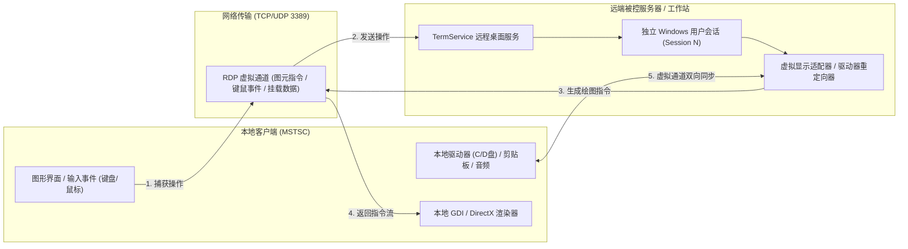

# MSTSC 与 RDP 远程桌面协议

> 一句话说明：Windows 自带的系统级远程桌面连接程序（Microsoft Terminal Services Client），基于微软专有 RDP 协议，通过“图形图元指令重定向”实现低带宽、极致文本清晰度与无缝设备虚拟映射的远程控制。

---

## 先记住

- **程序与协议的关系**：`mstsc.exe` 是 Windows 内置的**客户端前端程序**；而真正的灵魂是其底层运行的 **RDP（Remote Desktop Protocol，远程桌面协议）**，默认通信端口为 **TCP / UDP 3389**。
- **核心工作方式是“指令流重定向”，而非“抓屏录制视频流”**：
  - 传统远程工具（向日葵、ToDesk、RayLink）是把屏幕当成视频录制编码后推流；
  - **MSTSC/RDP 是把绘制指令（画一条线、渲染特定字体的文本框、移动窗口）直接发送给客户端**，由客户端本地显卡重新执行渲染，因此**字体边缘 100% 锐利、完全无视频压缩噪点与模糊，且办公代码场景带宽占用极小（仅需几十 KB/s）**。
- **系统级会话隔离与隐私安全**：RDP 深入 Windows 内核会话管理器（Session Manager）。连接成功后，被控端的物理显示器会自动锁定（锁屏），防止办公室旁人窥视；同时建立独立的虚拟显示器与音频管道。
- **深度整合微软域单点登录**：支持 **NLA（Network Level Authentication，网络级别身份验证）**，客户端在建立图形连接前就通过 Kerberos 完成鉴权，有效防御针对远程桌面服务的拒绝服务攻击与暴力破解。
- **强大的虚拟通道（Virtual Channels）支持**：支持双向无缝剪贴板文字与文件复制、本地硬盘驱动器直接挂载到远端（在远端“此电脑”直接读写本地 C/D 盘）、音频双向重定向以及智能卡/加密狗透传。

---

## 它在系统中做什么

在系统互联与远程运维中，MSTSC/RDP 提供了纯正的原生级控制通路：



- **解决的核心痛点**：
  1. **代码与文档模糊**：视频流远程桌面在网络波动或码率受限时，代码和文本会出现模糊重影；RDP 原生绘制文字，永远保持像素级锐利。
  2. **本地文件传输极其繁琐**：无需像聊天工具那样单独传文件，RDP 勾选“驱动器重定向”后，本地电脑的磁盘就像插了一个 U 盘一样直接出现在远程桌面的资源管理器中。
  3. **公网依赖与收费限制**：完全不经过任何第三方厂商的云端服务器，只要局域网或内网 VPN 打通，零限制、零计费、无广告。

---

## 工作机制：RDP vs 商业视频流远程（RayLink / UU远程）

| 比较维度 | MSTSC (微软原生 RDP) | 商业流媒体远程 (RayLink / UU远程 / 向日葵) |
|---|---|---|
| **底层核心机制** | **图形指令重定向 (GDI/Direct3D/DirectWrite)**，复杂区域动态回退位图 | **桌面抓取 ➔ 视频编码 (H.264/H.265/WebRTC) ➔ 传流 ➔ 本地解码** |
| **文字与代码清晰度** | **极致锐利（100% 原始矢量/点阵字）**，无色彩压缩，字迹不变形 | 取决于视频码率与色彩空间，可能存在 4:2:0 压缩色差或轻度模糊 |
| **网络带宽消耗** | **极低**（静态界面或打字时仅几十 KB/s） | **较高**（每秒持续传输 1~10 Mbps 连续视频流） |
| **3D动画与高刷动态** | 传统模式下帧率较低（30fps 左右）；需配置 GPU 策略加速 | **专精高帧率**（专为设计/游戏优化，支持 60~144Hz 低延迟流） |
| **网络穿透与组网** | **无内置打洞**，依赖纯内网直连、端口映射或内网穿透/VPN | **自带云端中继**，内置 STUN/TURN 协议，有网就能一键穿透连接 |
| **被控端屏幕状态** | **物理屏幕立即黑屏/锁屏**，防止现场人员看到操作 | 物理屏幕默认同步显示画面（防窥需手动开启虚拟屏/黑屏驱动） |
| **适用核心场景** | **企业域内运维、写代码、阅读文档、服务器管理、局域网办公** | **跨外网远程、高刷新动态游戏、三维建模/剪辑、远程协助小白** |

---

## 常用操作、快捷参数与配置

### 1. 快速启动与高频参数
- 呼出客户端：`Win + R` ➔ 输入 `mstsc` ➔ 回车。
- **连接管理会话**（强制连接控制台 0 会话）：
  ```cmd
  mstsc /v:10.1.33.200 /admin
  ```
- **全屏并跨越多显示器**（将本地所有显示器作为远程虚拟屏）：
  ```cmd
  mstsc /v:10.1.33.200 /multimon
  ```
- **限制全屏跨度**（老版本 Windows 平铺模式）：
  ```cmd
  mstsc /v:10.1.33.200 /span
  ```

### 2. 核心功能项配置（选项设置）
- **显示 (Display)**：调节远程桌面分辨率、颜色深度（推荐 32 位真彩色）。
- **本地资源 (Local Resources)**：
  - **剪贴板**：必须勾选，实现无缝 `Ctrl+C` / `Ctrl+V`。
  - **详细信息 ➔ 驱动器**：勾选本地需要共享的盘符（如 `C:`、`D:`），远程电脑直接访问。
- **体验 (Experience)**：根据网络速度选择（局域网建议选择“LAN (10 Mbps 或更高)”，开启字体平滑）。

---

## 常见误区与使用建议

- **误区一：把 3389 端口直接映射到公网使用**
  - *重大安全警告*：全球互联网上有成千上万台扫描器 24 小时针对 3389 端口进行暴力破解或利用系统漏洞（如历史上的 BlueKeep 漏洞）打入勒索病毒。**严禁在公网路由器上直接映射 3389 端口**；外网访问必须先连接公司 VPN（如 WireGuard / SSL VPN）或通过微软 RD Gateway 反向代理（443 端口）。
- **误区二：Windows 家庭版连不上别人**
  - *正确理解*：Windows 家庭版**内置了完整的 MSTSC 客户端，可以任意连接其他专业版/服务器电脑**；只是家庭版自身无法作为“被控端”（系统服务层被微软阉割了 TermService 侦听功能）。
- **误区三：MSTSC 只能连接 Windows**
  - *正确理解*：Linux 服务器只需安装 `xrdp` 服务，MSTSC 同样可以连接 Linux 的图形桌面（GNOME / XFCE）；且 macOS / iOS / Android 也有微软官方的《Microsoft Remote Desktop》客户端。

---

## 推荐检查与排查清单

- [ ] **被控端开启服务**：进入【Windows 设置 ➔ 系统 ➔ 远程桌面】，将“启用远程桌面”开关打开。
- [ ] **防火墙规则验证**：
  ```powershell
  Get-NetFirewallRule -DisplayGroup "远程桌面" | Select-Object Name, Enabled, Direction
  ```
- [ ] **端口侦听状态自检**：
  ```powershell
  Get-NetTCPConnection -LocalPort 3389 -State Listen -ErrorAction SilentlyContinue
  ```
- [ ] **网络连通性测试（从客户端测试目标主机）**：
  ```powershell
  Test-NetConnection -ComputerName 10.1.x.x -Port 3389
  ```
- [ ] **权限检查**：非管理员域账号若要被允许远程，需要在被控端【选择可远程访问这台电脑的用户】中将其加入授权列表。

---

## 关联笔记

- [[04-工具/远程与系统管理/00、远程与系统管理工具总览|远程与系统管理工具总览]]
- [[04-工具/远程与系统管理/01、微软域与Active Directory域服务|微软域与Active Directory域服务]]
- [[04-工具/00、工具总览]]
