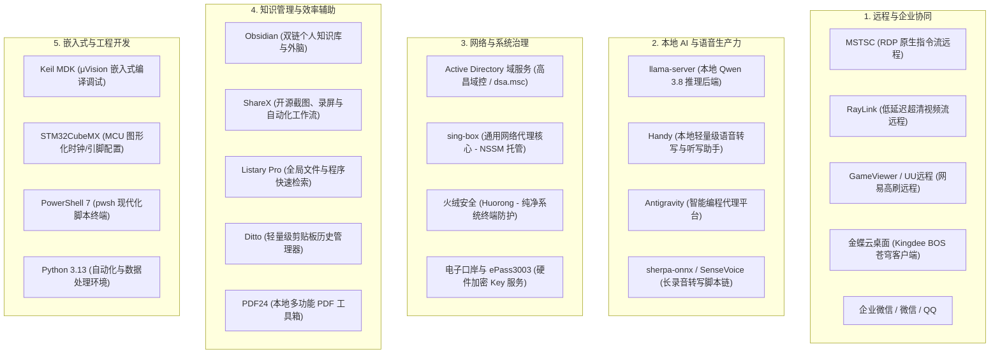

# 本机在用工具与效率全景

> 一句话说明：全面梳理与记录当前工作站（`GZDZ0098`）实际常驻、运行中的软硬件开发、远程协同、本地 AI 及系统管理工具栈。

---

## 先记住

- **工作站核心定位**：这是一台深度融合了**企业集中管控（高昌域 `corp.gaochang.com`）**、**嵌入式软硬件研发（Keil/STM32）**、**多通道远程连接（RDP/RayLink/GameViewer）** 与 **本地私有化 AI / 知识体系（llama-server/Handy/Obsidian）** 的复合型生产力终端。
- **工具链分层清晰**：从底层的网络与域安全，到中间的业务与远程，再到顶层的研发与 AI 增强，各司其职且互为补充。
- **本地优先与数据可控**：核心知识库（Obsidian）、大模型推理（llama-server + Qwen）、音频转写（SenseVoice / Handy）均优先在本地完成，避免企业私有代码与设计图纸外流。

---

## 本机常驻工具全景矩阵

---

## 核心工具模块详细解析

### 一、远程桌面与企业协同类

| 工具名称 | 对应主进程 / 路径 | 核心作用与使用场景 |
|---|---|---|
| **MSTSC (Windows 远程桌面)** | `mstsc.exe` (系统内置) | **基于 RDP 指令流重定向**。用于局域网或内网跨机管理、读代码与写文档，文字极致锐利，带宽仅几十 KB/s。物理屏自动锁屏防窥。 |
| **RayLink** | `RayLink.exe` (`Program Files (x86)\RayLink`) | **基于流媒体超清低延迟编码**。针对电竞与设计优化，支持高刷帧率与 4:4:4 全色彩，带 NAT 云端打洞，适合无公网环境下的远程控制。 |
| **GameViewer (UU远程)** | `GameViewer.exe` (`Program Files\Netease\GameViewer`) | 网易开发的高性能远程控制客户端。专精高动态画面的流畅同步，适合高清多屏协同与远端动态验证。 |
| **金蝶云桌面 (Kingdee Cloud)** | `Kingdee.BOS.XPF.App` (后台服务托管) | 企业级 ERP、供应链、生产订单与财务核算系统的专用桌面客户端，对接金蝶云·苍穹 / 星空平台。 |
| **企业微信 / 微信 / QQ** | `WXWork.exe` / `Weixin.exe` / `QQ.exe` | 企业内外部协同沟通、文件流转与项目会议枢纽。 |

### 二、本地 AI 与语音生产力类

| 工具名称 | 对应主进程 / 路径 | 核心作用与使用场景 |
|---|---|---|
| **llama-server** | `llama-server.exe` (`C:\AI\Qwen3.8\runtime`) | **本地大模型高性能推理引擎**。在本地硬件上直接加载和运行 Qwen 3.8 等前沿开源大模型，提供兼容 OpenAI 的本地 API，完全离线运行。 |
| **Handy** | `handy.exe` (`AppData\Local\Handy`) | **本地轻量级语音识别与听写输入助手**。支持全局快捷键呼出，实时将口述语音精准转换为文本并输入到当前活跃窗口。 |
| **Antigravity** | `Antigravity.exe` (`AppData\Local\Programs\antigravity`) | Google Deepmind 智能编程助手与自动化代理工作流环境，深度赋能代码编写、系统探查与知识沉淀。 |
| **SenseVoice / sherpa-onnx** | Python 自动化脚本链 (`04-工具/语音识别/脚本`) | 专门针对企业长录音（如余总面试、生产会议）的带时间戳离线转写与自动摘要工具链。 |

### 三、网络安全与系统治理类

| 工具名称 | 对应主进程 / 路径 | 核心作用与使用场景 |
|---|---|---|
| **Active Directory 域服务** | `lsass.exe` / `winlogon.exe` / `dsa.msc` | **企业级身份与组策略中枢**。加入高昌企业域 `corp.gaochang.com`，实现账号凭证单点登录（SSO）、Kerberos 票据认证与集中 IT 安全管控。 |
| **sing-box** | `sing-box.exe` (由 `nssm` 注册为系统自启服务) | 现代化通用网络代理核心，提供高性能、低内存占用的网络路由、分流与连接加速支持。 |
| **火绒安全 (Huorong)** | `HipsTray.exe` (`Program Files\Huorong\Sysdiag`) | 国产轻量级主机安全软件，纯净无弹窗，提供底层行为拦截、恶意代码防护与实用弹窗拦截功能。 |
| **中国电子口岸 / ePass3003** | `GFA_certd3003.exe` / `CnEport.Pub...` | 企业海关报关、电子口岸业务专用的硬件 USB 密码钥匙（ePass 3003）驱动与安全认证服务。 |

### 四、知识管理与系统效率辅助类

| 工具名称 | 对应主进程 / 路径 | 核心作用与使用场景 |
|---|---|---|
| **Obsidian** | `Obsidian.exe` (`AppData\Local\Programs\Obsidian`) | **第二大脑核心宿主**。基于本地纯 Markdown 格式与双向链接，沉淀嵌入式系统、项目架构、现场工作日志与工具手册。 |
| **ShareX** | `ShareX.exe` (便携/安装版) | **开源截图与自动化流水线利器**。支持精准选区、气泡序号标注、长截图、动图 GIF 录制与一键生成 Obsidian 图片引用。 |
| **Listary Pro** | `ListaryService.exe` / 前端进程 | 双击 `Ctrl` 瞬间呼出的全局快速启动与文件深度检索工具，大幅缩短找文件和工程的时间。 |
| **Ditto** | `Ditto.exe` (系统托盘启动) | 开源剪贴板历史工具，记录所有复制过的文字与代码块，防止剪贴板丢失，支持批量粘贴。 |
| **PDF24** | `pdf24.exe` (系统后台常驻) | 纯本地运行的无限制多功能 PDF 工具集，支持页面提取、合并、拆分、压缩与转格式。 |

### 五、嵌入式研发与系统开发类

| 工具名称 | 对应主进程 / 路径 | 核心作用与使用场景 |
|---|---|---|
| **Keil MDK (μVision)** | `UV4.exe` (`C:\Keil_v5` 等) | ARM Cortex-M 嵌入式微控制器（STM32 / MSPM0 等）经典开发 IDE，负责 C 代码编译、代码优化与 J-Link/DAP 固件下载。 |
| **STM32CubeMX** | `STM32CubeMX.exe` | ST 官方外设图形化配置工具，自动生成引脚时钟树、中断配置与 HAL 库初始化驱动。 |
| **PowerShell 7 (pwsh)** | `pwsh.exe` (`Program Files\PowerShell\7`) | 基于 .NET 现代核心的高性能终端，拥有强大的对象管道、跨平台脚本能力与系统运维管理接口。 |
| **Python 3.13** | `python.exe` (`Program Files\Python313`) | 解释型脚本环境，支撑数据处理、AI 自动化处理脚本与自定义小工具。 |

---

## 关联笔记

- [[04-工具/远程与系统管理/00、远程与系统管理工具总览|远程与系统管理工具总览]]
- [[04-工具/远程与系统管理/01、微软域与Active Directory域服务|微软域与Active Directory域服务]]
- [[04-工具/远程与系统管理/02、MSTSC与RDP远程桌面协议|MSTSC与RDP远程桌面协议]]
- [[04-工具/00、工具总览]]
