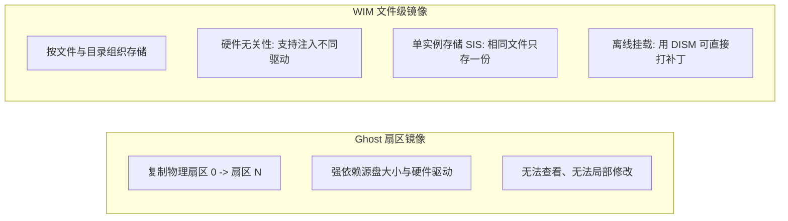
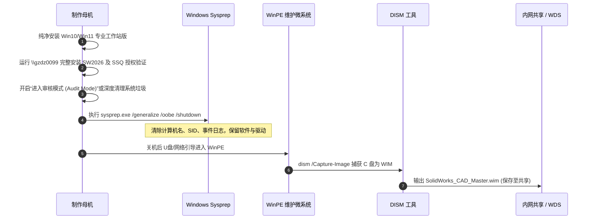

# WIM 系统镜像封装与组策略 (GPO) 软件推送

> 一句话说明：针对 SolidWorks 等超大型（20GB~30GB+）工业设计软件在企业局域网的标准化交付范式——利用 `.wim` 制作集成依赖环境的“黄金镜像”实现快速装机，或借助 Active Directory 域组策略（GPO）通过内网 UNC 共享网络拉取实现远程批量无人值守静默推送。

---

## 先记住

- **老板教的技术栈本质**：
  - `\\gzdz0099\DS.SolidWorks.2026.SP4.1.Premium-SSQ`：内网专用工作站/文件服务器 `GZDZ0099` 上的 SMB 共享文件夹（当前本机为 `GZDZ0098`，同属技术部门局域网环境）。
  - `.wim` **解决“从无到有”的部署效率**：将操作系统、显卡驱动、VC++ 运行库以及庞大的 SolidWorks 完整安装在一台测试机上，去除机器唯一标识后捕获为 `.wim` 镜像，新机几分钟灌装完毕，免去单机长达 2 小时的繁琐安装。
  - **组策略推送解决“统一管控与批量下发”**：依托公司 `corp.gaochang.com` 域控制器，在研发部门电脑开机时，后台以最高管理员（`SYSTEM`）身份拉取共享脚本，执行无人值守安装。
- **“先解释再推送”的核心认知**：
  1. **解释阶段**：搞清 `.wim` 的单实例文件存储原理，以及 GPO 开机脚本与 `NT AUTHORITY\SYSTEM` 机器账户的权限边界。
  2. **推送阶段**：将安装包制作成无弹窗的管理映像（Administrative Image），结合批处理/PowerShell 静默参数与注册表配置，通过 GPMC 控制台按 OU（组织单位）精准下发。
- **三大生死红线（老运维血泪经验）**：
  1. **共享读取权限**：`\\gzdz0099` 的共享与 NTFS 权限中，**必须给 `Domain Computers`（域计算机）读取权限**，不能只给员工域账号，因为开机脚本是在员工还没登录前由“计算机硬件”执行的。
  2. **脚本等待超时**：Windows 启动脚本默认最长只运行 10 分钟，而 20多 GB 的 SolidWorks 千兆内网传输加解压安装往往需要 15~30 分钟，必须在 GPO 中将“启动脚本最长等待时间”设为 `0`（不限制）。
  3. **SSQ 授权先行**：SolidWorks 的 SSQ 机制依赖特定注册表及虚拟许可服务，静默安装脚本中必须**先导入许可证注册表/配置服务，后运行主安装程序**。

---

## 三者的本质定位与协同关系（核心心智模型）

如果把企业 IT 运维比作**“交楼装修”**，这三者的关系一目了然：

| 实体 | 技术属性 | 通俗隐喻 | 在体系中的不可替代作用 |
| :--- | :--- | :--- | :--- |
| **`\\gzdz0099\SolidWorks...`** | **静态资源源端** (UNC SMB 共享) | **建材总仓库**（沉重的家具家电） | **“货物本身”**：存放 25GB 的完整安装包、VC++ 运行环境与 SSQ 许可证文件，是所有安装行为的唯一真实源头（Single Source of Truth）。 |
| **`.wim` 镜像封装** | **系统级静态容器** (File-based Image) | **精装样板房**（出厂时直接把家具焊在墙里） | **“交付底座”**：在母机上把操作系统与 SolidWorks 预先深度融合，解决**“新机从 0 到 1 安装太慢”**的矛盾（灌装仅需 10 分钟）。 |
| **组策略推送 (GPO)** | **域控集中调度机制** (AD Group Policy) | **物业自动派工单**（全小区开机广播通知） | **“自动化流水线”**：下达“谁装、何时装、以何权限装”的管理意志，解决**“已有电脑批量补装与版本更新”**的矛盾（无需网管跑断腿）。 |

### 1. 三者协同的时空生命周期图谱

它们并不是互相排斥的单选项，而是在**计算机生命周期的不同阶段**互相咬合、分工协作：

```mermaid
graph TD
    subgraph 资源中枢
        SHARE["\\gzdz0099 共享仓库<br>(SolidWorks 2026 安装源 + SSQ)"]
    end

    subgraph 阶段一：新电脑出厂交付 (Day 0)
        SHARE -->|一次性完整安装并调优| MASTER["母机测试电脑"]
        MASTER -->|Sysprep通用化 + DISM抓取| WIM[".wim 黄金底包"]
        WIM -->|U盘 / WDS网络启动极速刷入| NEW_PC["新研发电脑<br>(开机自带 SolidWorks，耗时10分钟)"]
    end

    subgraph 阶段二：存量电脑日常运维与补丁 (Day 1 ~ Day N)
        GPO["AD域组策略 (GPO)<br>(计算机启动策略 + 权限委派)"]
        GPO -->|开机时下发执行指令| RUNNING_PC["员工在用电脑<br>(如 GZDZ0098)"]
        SHARE -.->|网络静默拉取安装包| RUNNING_PC
    end

    classDef store fill:#e1f5fe,stroke:#01579b,stroke-width:2px;
    classDef wim fill:#e8f5e9,stroke:#2e7d32,stroke-width:2px;
    classDef gpo fill:#fff3e0,stroke:#e65100,stroke-width:2px;
    class SHARE store;
    class WIM wim;
    class GPO gpo;
```

### 2. 深度制约与互补逻辑：为什么缺一不可？

- **`\\gzdz0099` 离不开 `GPO`**：
  没有 GPO，共享文件夹只是一个死寂的网盘，依然需要网管一台台去点击运行、输入路径、手动点“下一步”；有了 GPO，共享目录才变成了**全自动分发管道**。
- **`GPO` 离不开 `\\gzdz0099`**：
  域控制器自身的 SYSVOL 共享存储极其有限（通常仅几十 MB），**绝对不能**把 20GB 的 SolidWorks 塞进域控主机（否则域控复制会被挤爆崩溃），必须外挂内网独立的高速文件服务器（`GZDZ0099`）作为支撑。
- **`.wim` 与 `GPO` 的动态互补**：
  - **静态前置（.wim）**：适合重资产。SolidWorks 动辄几十 GB，最适合做进 `.wim` 封装底包，避开网络拥堵；
  - **动态后置（GPO）**：适合轻策略与更新。比如后续 SolidWorks 出了 SP4.2 补丁、或者 SSQ 许可证服务器 IP 变了，你不可能为了改一个 IP 去把几十台电脑重新刷一遍 `.wim`，这时必须靠 `GPO` 远程下发一个注册表小脚本，一秒钟批量修正。

---

## 它在系统中做什么

在制造研发与工业自动化企业（如高昌升降机机械设计部门）中，研发工程师的工作站需要统一、稳定且高度标准化的 CAD 环境：

```mermaid
flowchart TD
    subgraph 资源准备端["共享存储源端 (\\gzdz0099)"]
        SOURCE["SolidWorks 2026 SP4.1 安装源"]
        SSQ["_SolidSQUAD_ 许可与破解补丁"]
        BATCH["静默安装控制脚本 (install_sw.bat)"]
        SOURCE --- SSQ --- BATCH
    end

    subgraph 技术栈一：WIM黄金镜像封装["技术栈一：.WIM 黄金镜像封装交付"]
        M1["母机完整安装 OS + SW2026 + 驱动"] --> M2["Sysprep 通用化 (清除 SID 与硬件绑定)"]
        M2 --> M3["WinPE 离线环境使用 DISM 捕获 .wim 镜像"]
        M3 --> M4["新研发电脑批量灌装 (10分钟交付即用)"]
    end

    subgraph 技术栈二：AD域组策略推送["技术栈二：组策略 (GPO) 远程静默推送"]
        DC["域控 (GzDc02.corp.gaochang.com)"] -->|GPMC 挂载启动脚本| GPO["计算机启动策略 (Startup Script)"]
        GPO -->|通知研发部 OU 终端| CLIENT["客户端工作站 (如 GZDZ0098)"]
        CLIENT -->|开机时以 SYSTEM 权限访问| BATCH
        BATCH -->|无界面静默执行| CLIENT_INSTALL["后台静默完成安装与授权"]
    end

    SOURCE -.-> M1
    BATCH -.-> GPO
```

- **解决的核心痛点**：
  1. **安装耗时巨大**：SolidWorks 完整安装包超 20GB，依赖项包括 .NET Framework、10 多个版本的 VC++ Redistributable、Bonjour、VBA 脚本引擎、SQL Server Express（PDM 组件）。如果人工逐台点击下一步，10 台电脑需要运维耗费整整两天。
  2. **配置不一致导致的协作灾难**：团队成员如果安装了不同 Service Pack（例如 SP1 与 SP4.1）或模板库路径不一致，将导致三维装配体模型格式不兼容、协同出图报错。
  3. **授权激活维护繁琐**：通过脚本和策略实现 SSQ 服务的集中化或预先配置，杜绝员工私自操作导致许可证报错。

---

## 技术栈深度原理解析（先解释）

### 1. 深度解析：.WIM (Windows Imaging Format) 镜像封装

#### 什么是 WIM？
`.wim` 是微软自 Windows Vista 时代引入的**基于文件（File-based）**的高级磁盘映像格式，彻底取代了早期老旧的 Ghost（基于磁盘物理扇区 Sector-based 的克隆）。



#### 为什么大型工程软件首选 WIM 预装？
- **硬件解耦（HAL 独立）**：WIM 镜像与主板芯片组、CPU 型号无关。一台 Dell 台式机封装的系统，可以恢复到 ThinkPad 或组装工作站上，开机自动适配硬件并安装对应驱动。
- **单实例存储（Single-Instance Storage, SIS）**：Windows 内部和 SolidWorks 各模块若有重复的运行库 DLL，WIM 在压缩时只会保留一份文件实体，多次引用，极大缩减镜像体积。
- **可离线维护性（DISM）**：运维无需开机，只需在命令行执行 `dism /Mount-Wim`，就能把 WIM 挂载为一个普通文件夹，直接替换其中的授权文件、注入网卡驱动或打入 Windows 安全补丁，再执行 `dism /Unmount-Wim /Commit` 即可完成更新。

---

### 2. 深度解析：Active Directory 域“组策略推送” (GPO Push)

#### 为什么叫“推送”？
在 Windows 域环境下，“推送”并不是服务器主动向客户端建立 TCP 连接灌装数据（那是 SCCM / Intune 的高级行为），而是**域控制器（DC）集中发布规则，由客户端在触发特定生命周期（开机、关机、用户注销、或每隔 90 分钟周期轮询）时，自动从 SYSVOL 共享拉取策略并执行**。

#### 软件分发的核心载体对比

| 分发方式 | 原理机制 | 适用文件类型 | 优缺点分析 | 是否适合 SolidWorks |
| :--- | :--- | :--- | :--- | :--- |
| **GPO 原生软件安装 (Software Installation)** | 基于 Windows Installer 服务，域控指定 MSI 安装包 | **仅支持 `.msi`** | 优点：原生集成，支持自动卸载。<br>缺点：**无法处理复杂的依赖注入、无法安装 SSQ 破解服务、不支持超大分块目录**。 | ❌ **不适合**（SW 结构过于庞杂） |
| **GPO 启动脚本 (Startup Script)** ⭐ | 配置在 `计算机配置` 下的批处理 (`.bat`) 或 PowerShell (`.ps1`) | **任意可执行程序、脚本、注册表** | 优点：**图灵完备**，可编排前置判断、权限校验、日志输出、安装与激活。<br>缺点：需编写健壮的容错脚本。 | ✅ **最佳生产实践** |
| **GPO 首选项计划任务 (GPP Scheduled Task)** | 组策略在客户端创建一条“以 SYSTEM 权限运行一次”的计划任务 | 脚本或安装程序 | 优点：不卡开机黑屏，用户进入桌面后后台慢慢跑。<br>缺点：需要管理计划任务生命周期。 | 🟡 **次选方案** |

#### 为什么必须用“计算机启动脚本”而非“用户登录脚本”？
- **权限维度**：SolidWorks 安装需要往 `C:\Program Files`、注册表 `HKEY_LOCAL_MACHINE` 写入系统服务，必须拥有本地最高管理员权限。
  - **用户登录脚本**：以当前登录员工（普通域用户，Domain Users）权限运行，**无权安装软件**。
  - **计算机启动脚本**：以 `NT AUTHORITY\SYSTEM`（本地系统账户）运行，拥有无限制的系统底层最高权限，天然免疫 UAC 弹窗阻拦。
- **时机维度**：开机阶段员工尚未登录，避免员工因操作鼠标打断安装进度，或因未装完强行启动软件导致崩溃。

---

## 落地实操指南：从 0 到 1 完整实现（再推送）

### 方案 A 实操：制作包含 SolidWorks 2026 的 `.wim` 黄金镜像

当你需要为公司新购入的电脑、或者需要统一重装系统的研发电脑批量部署时，采用此方案。



#### 第 1 步：母机配置与环境准备
1. 找一台硬件配置适中的电脑作为“母机”，安装纯净 Windows 11 专业版/工作站版。
2. 安装所有主板驱动、独立显卡驱动（NVIDIA Studio / 专业驱动）。
3. 访问 `\\gzdz0099\DS.SolidWorks.2026.SP4.1.Premium-SSQ`，运行安装程序并完成全部组件配置、SSQ 激活。
4. 打开 SolidWorks 新建零件、装配体、工程图，测试运行正常。

#### 第 2 步：Sysprep 通用化（系统封装最核心命令）
必须消除母机的硬件特定信息与安全标识符（SID），否则灌装到其他电脑会造成域内 SID 冲突：
以管理员身份打开 CMD，执行：
```cmd
C:\Windows\System32\Sysprep\sysprep.exe /generalize /oobe /shutdown
```
- `/generalize`：**通用化核心参数**。清理系统唯一的安全 ID (SID)、重置激活计时器、移除硬件驱动绑定。
- `/oobe`：让系统在新机第一次开机时进入“全新启动引导（Out-of-Box Experience）”，自动重新检测硬件并生成新计算机名。
- `/shutdown`：通用化完成后立即关机，**千万不能重新开机进入系统**！

#### 第 3 步：进入 WinPE 使用 DISM 抓取镜像
电脑关机后，插入 WinPE 启动盘引导开机，打开 PE 命令行：
```cmd
dism /Capture-Image /ImageFile:D:\SolidWorks_Win11_GoldMaster.wim /CaptureDir:C:\ /Name:"Win11_SW2026_x64" /Description:"高昌技术部SW2026专用黄金镜像" /Compress:max /Verify
```
- `/CaptureDir:C:\`：母机系统的系统盘。
- `/Compress:max`：采用最高比例压缩，有效减少镜像文件体积。
- `/Verify`：开启数据校验，防止 WIM 镜像抓取过程中出现坏块。

> [!tip] 恢复与交付
> 以后新机器只需在 PE 中运行一句还原命令即可完成系统和工业软件的全部部署：
> `dism /Apply-Image /ImageFile:Z:\SolidWorks_Win11_GoldMaster.wim /Index:1 /ApplyDir:C:\`

---

### 方案 B 实操：利用 AD 域组策略 (GPO) 静默推送软件

当公司已有几十台电脑已经在正常运行，且电脑已加入 `corp.gaochang.com` 域，需要批量统一静默补发 SolidWorks 2026 时，采用此方案。

#### 第 1 步：编写生产级静默安装脚本

在内网共享目录 `\\gzdz0099\DS.SolidWorks.2026.SP4.1.Premium-SSQ` 下创建脚本 `silent_install.bat`。

> [!important] 脚本必须具备“幂等性”
> 启动脚本每次开机都会触发，如果脚本不先检查电脑是否已装好软件，就会导致电脑每次开机都在后台反复重装！

```cmd
@echo off
setlocal enabledelayedexpansion

:: ========================================================
:: 高昌研发工作站 SolidWorks 2026 SP4.1 自动推送脚本
:: 执行上下文：NT AUTHORITY\SYSTEM (开机启动脚本)
:: ========================================================

:: 1. 定义环境常量与路径
set LOG_FILE=C:\Windows\Temp\SW2026_Install.log
set INSTALL_FLAG=C:\Windows\SW2026_Installed.flag
set SW_TARGET=C:\Program Files\SOLIDWORKS Corp\SOLIDWORKS\SLDWORKS.exe
set SW_SOURCE=\\gzdz0099\DS.SolidWorks.2026.SP4.1.Premium-SSQ

echo ======================================================== >> %LOG_FILE%
echo [%date% %time%] 启动 SolidWorks 2026 自动部署任务... >> %LOG_FILE%

:: 2. 幂等性检测：若主程序存在或已生成标记文件，则立即退出
if exist "%SW_TARGET%" (
    echo [%date% %time%] 检测到已安装 SolidWorks，跳过执行。 >> %LOG_FILE%
    exit /b 0
)
if exist "%INSTALL_FLAG%" (
    echo [%date% %time%] 检测到已存在安装标记文件，跳过执行。 >> %LOG_FILE%
    exit /b 0
)

:: 3. 连通性检测：校验能否访问内网共享服务器
if not exist "%SW_SOURCE%" (
    echo [%date% %time%] 错误：无法访问安装源 %SW_SOURCE%，可能网络未就绪或权限不足。 >> %LOG_FILE%
    exit /b 1
)

:: 4. 优先注入 SSQ 授权注册表 (根据 SolidSQUAD 部署规则)
echo [%date% %time%] 正在静默导入 SSQ 序列号注册表... >> %LOG_FILE%
if exist "%SW_SOURCE%\_SolidSQUAD_\sw2026_network_serials_licensing.reg" (
    regedit /s "%SW_SOURCE%\_SolidSQUAD_\sw2026_network_serials_licensing.reg"
)

:: 5. 启动无人值守静默安装
:: 选项说明：
:: /adminclient : 作为管理映像客户端运行
:: /runinstall  : 立即启动安装
:: /now         : 无需人工确认直接执行
:: /qb          : 显示极简进度条（或使用 /qn 实现完全无界面静默）
echo [%date% %time%] 正在调用安装引擎，开始静默解压与安装... >> %LOG_FILE%

start /wait "" "%SW_SOURCE%\sldim\sldim.exe" /adminclient /runinstall /now >> %LOG_FILE% 2>&1
set EXIT_CODE=%errorlevel%

echo [%date% %time%] 安装引擎执行完毕，退出代码: %EXIT_CODE% >> %LOG_FILE%

:: 6. 安装结果判断与打标
if exist "%SW_TARGET%" (
    echo [%date% %time%] SolidWorks 2026 部署成功！生成标记文件。 >> %LOG_FILE%
    echo Installed on %date% %time% with ExitCode %EXIT_CODE% > "%INSTALL_FLAG%"
    exit /b 0
) else (
    echo [%date% %time%] 警告：未检测到主程序生成，请检查日志与网络传输。 >> %LOG_FILE%
    exit /b %EXIT_CODE%
)
```

---

#### 第 2 步：配置域控组策略 (GPMC 控制台操作)

1. **登录域控服务器（如 `GzDc02`）**，按 `Win + R` 输入 `gpmc.msc`，打开**组策略管理**。
2. **选择目标组织单位 (OU)**：
   - 找到研发部电脑所在的 OU：
     `corp.gaochang.com` -> `GC` -> `1-用户及电脑Users` -> `101-广州` -> `21技术部`。
   - 右键该 OU -> **“在这个域中创建 GPO 并在此处链接”**，命名为：
     `Policy-Deploy-SolidWorks2026`。
3. **设置开机超时限制（必配项！）**：
   - 右键编辑该 GPO，定位到：
     `计算机配置` -> `管理模板` -> `系统` -> `脚本`。
   - 双击 **“指定启动脚本的最长等待时间”**，设置为 **已启用**，超时秒数填 `0`（表示无限制）或 `3600`（1小时）。
4. **确保开机网络已就绪（必配项！）**：
   - 定位到：`计算机配置` -> `管理模板` -> `系统` -> `登录`。
   - 双击 **“计算机启动和登录时始终等待网络”**，设置为 **已启用**。
5. **挂载启动脚本**：
   - 定位到：`计算机配置` -> `Windows 设置` -> `脚本 (启动/关机)` -> 双击 **启动 (Startup)**。
   - 点击 **添加 (Add)**：
     - 脚本名：填入 UNC 路径 `\\gzdz0099\DS.SolidWorks.2026.SP4.1.Premium-SSQ\silent_install.bat`（或将脚本放入 GPO 的 SYSVOL 目录内）。
6. **保存策略并发布**。

---

## 关键命令、参数与配置速查表

### 1. DISM 核心命令速查 (WIM 维护)

| 场景 | 完整命令 | 关键说明 |
| :--- | :--- | :--- |
| **捕获镜像** | `dism /Capture-Image /ImageFile:D:\os.wim /CaptureDir:C:\ /Name:"BaseOS"` | 将 C 盘捕获为 `os.wim` |
| **释放/安装镜像** | `dism /Apply-Image /ImageFile:D:\os.wim /Index:1 /ApplyDir:C:\` | 将镜像还原到 C 盘分区 |
| **挂载修改** | `dism /Mount-Wim /WimFile:D:\os.wim /Index:1 /MountDir:C:\Mount` | 将 WIM 挂载为物理目录 |
| **保存并卸载** | `dism /Unmount-Wim /MountDir:C:\Mount /Commit` | 保存离线注入的驱动/补丁 |
| **查看镜像信息**| `dism /Get-WimInfo /WimFile:D:\os.wim` | 查看包含哪些子卷（Index） |

### 2. GPO 客户端调试与排错命令速查

| 目的 | 命令 | 使用说明 |
| :--- | :--- | :--- |
| **强制立刻刷新组策略** | `gpupdate /force` | 强制客户端向域控重新同步所有策略 |
| **查看应用的策略结果** | `gpresult /r` | 查看当前计算机和用户命中了哪些 GPO |
| **导出完整 HTML 诊断报告** | `gpresult /h C:\gpreport.html` | 最权威的排查工具，能看具体策略为何失败 |
| **模拟 SYSTEM 账户调试** | `psexec -i -s cmd.exe` | 启动 SYSTEM 权限终端，测试能否读取共享 |

---

## 常见踩坑与故障排查（Troubleshooting）

### 坑点 1：SYSTEM 账户无权访问 `\\gzdz0099` 共享目录
- **现象**：在客户端手动点批处理能安装，但放到 GPO 开机启动脚本里就报错，日志提示“拒绝访问 (Access is denied)”或找不到路径。
- **根本原因**：手动执行用的是你自己的登录域账号（如 `juncheng.liu`）；而 GPO 启动脚本运行在 `NT AUTHORITY\SYSTEM` 下，在局域网内出示的是**计算机账号（`DOMAIN\GZDZ0098$`）**！
- **解决方案**：
  1. 登录 `GZDZ0099` 服务器，右键该共享文件夹 -> **属性** -> **共享** -> **高级共享** -> **权限**。
  2. 点击添加，对象类型勾选“计算机”，输入 `Domain Computers`（所有域计算机）或 `Everyone`，赋予**读取**权限。
  3. 切换到 **安全 (NTFS)** 选项卡，同样添加 `Domain Computers` 赋予“读取和执行”权限。

### 坑点 2：开机安装超时导致电脑强行进入登录界面，安装被腰斩
- **现象**：软件装到一半文件损坏，快捷方式有了但点击弹窗缺少 DLL。
- **根本原因**：Windows 组策略启动脚本默认具有 10 分钟（600 秒）超时断开保护。如果网络拥堵或安装慢，系统会强制 Kill 掉批处理进程。
- **解决方案**：必须在域控策略中启用 `指定启动脚本的最长等待时间` 并设为 `0`（无限等待）或足够长（如 3600 秒）。

### 坑点 3：Sysprep 通用化报错“无法验证 Windows 安装 (0x80073cf2)”
- **现象**：在母机上运行 `sysprep /generalize` 时提示错误，查看 `C:\Windows\System32\Sysprep\Panther\setuperr.log` 发现某个 AppX 商店应用（如 Xbox、Clipchamp）阻止了通用化。
- **根本原因**：通过微软商店下载的单用户应用未经过系统预配，导致 Sysprep 判定多用户环境不一致。
- **解决方案**：
  在管理员 PowerShell 中卸载该有问题的 AppX：
  ```powershell
  Get-AppxPackage -AllUsers *应用名* | Remove-AppxPackage -AllUsers
  ```

### 坑点 4：SSQ 激活服务（SolidSQUAD License Server）通信受阻
- **现象**：SolidWorks 安装完成，打开时报错 `Could not obtain a license for SOLIDWORKS Standard. (-15, 570, 0)`。
- **根本原因**：
  - 找不到本地或内网的 FlexLM 虚拟许可证管理器服务。
  - 防火墙阻拦了许可证通信端口。
- **解决方案**：
  - 确认内网许可证服务器或本地服务已启动（服务名通常为 `SolidWorks Flexnet Server`）。
  - 检查客户端与服务器防火墙，放行 TCP 端口 `25734` 与 `25735`。

---

## 部署落地自检清单

- [ ] **源端准备**：`\\gzdz0099\DS.SolidWorks.2026.SP4.1.Premium-SSQ` 已就绪，且已对 `Domain Computers` 开放读取。
- [ ] **授权测试**：在测试单机上手动运行 SSQ 注册表和许可证，确认能够稳定激活。
- [ ] **脚本幂等性**：`silent_install.bat` 中已加入 `if exist SLDWORKS.exe exit /b 0` 检测，防止反复安装。
- [ ] **GPO 策略配齐**：
  - [ ] 启动脚本挂载正确。
  - [ ] “计算机启动和登录时始终等待网络”已启用。
  - [ ] “指定启动脚本的最长等待时间”已设为 `0` 或 `3600`。
- [ ] **分批灰度推送**：先在测试 OU（如挂载包含本机 `GZDZ0098` 的测试组）验证开机自动部署，确认无误后再链接到全技术部 OU。

---

## 关联笔记

- [[04-工具/远程与系统管理/00、远程与系统管理工具总览|远程与系统管理工具总览]]
- [[04-工具/远程与系统管理/01、微软域与Active Directory域服务|微软域与Active Directory域服务]]
- [[04-工具/远程与系统管理/03、本机在用工具与效率全景|本机在用工具与效率全景]]
- [[09-规则/AI写笔记套路|AI写笔记套路]]
